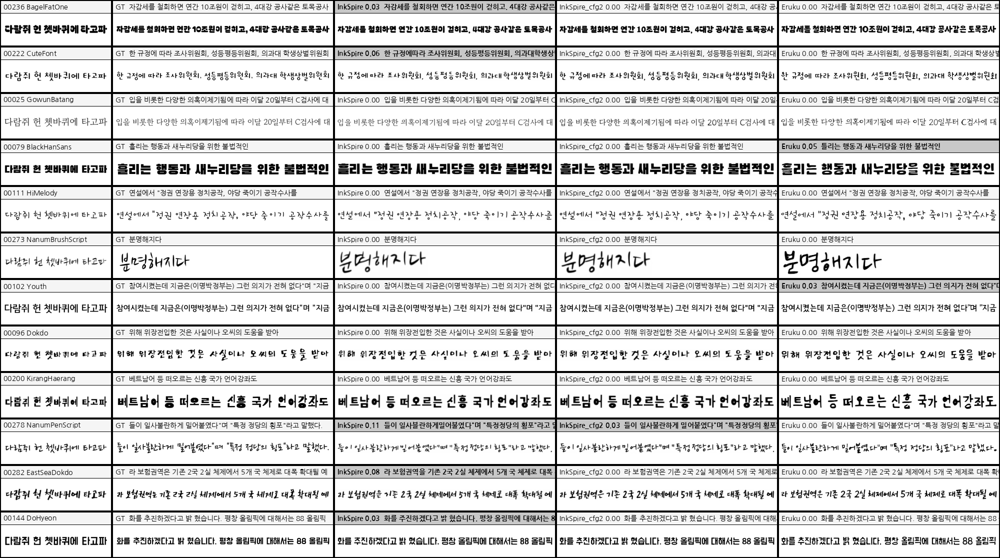
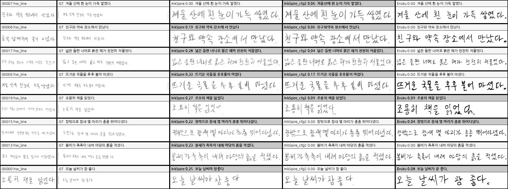
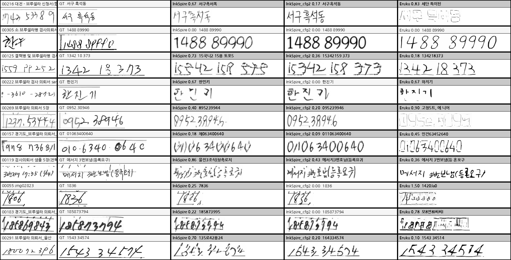
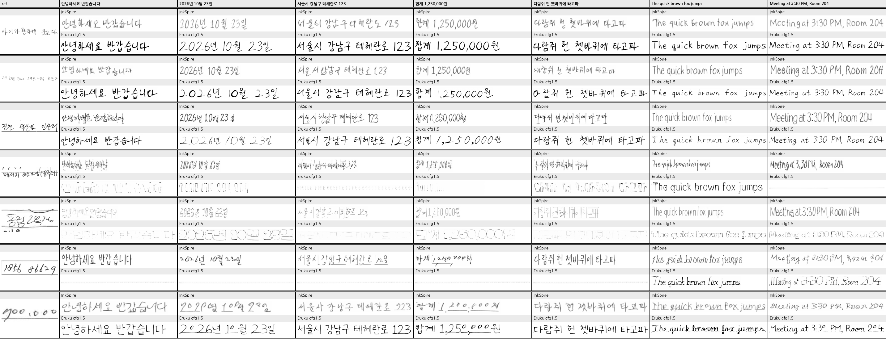
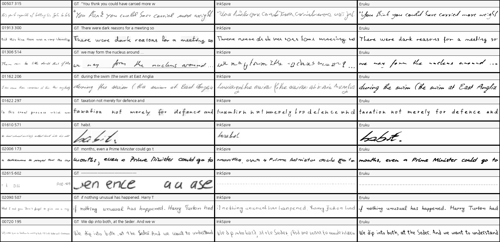

# InkSpire 한글 재현

[](https://huggingface.co/HERIUN/inkspire_korean) [](https://huggingface.co/spaces/HERIUN/eruku_korean_demo)

논문 *Learning to Generate Stylized Handwritten Text via a Unified Representation of Style,
Content, and Noise* (Wang et al., ICLR 2026, OpenReview `FBPuLChGNX`) 의 한글 재현 구현.
코드 미공개라 논문만 보고 구현했다. [Eruku_korean_finetuning](https://github.com/HERIUN/Eruku_korean_finetuning) 에서 분리해 나왔다.

- 설계·이슈·측정값: [`docs/inkspire.md`](docs/inkspire.md)
- HF 릴리즈(LoRA + Space): `tools/hf_release.py {model,space} [--push]` — 베이스는 gated·FLUX Kommunity(비상업)라 재배포 안 함, Space(Eruku 데모에 모델 선택으로 합침) 는 secret `HF_TOKEN` 으로 받는다

## ⚠️ 먼저 읽을 것 — 이 모델의 한계

쓰기 전에 알아야 손해를 안 본다. 아래는 전부 이 저장소에서 **측정·기록된** 것이고, 근거는 [`docs/EXPERIMENTS.md`](docs/EXPERIMENTS.md) 의 해당 절에 있다.

| 한계 | 실측 | 어떻게 대처하나 |
|---|---|---|
| **실제 사람 손글씨에서 글자가 틀린다** | 학습 writer 가 전부 **폰트**(12,951종)다. 실손글씨 문장 교차 생성 CER **0.246**(Eruku 0.014) — 폰트(0.023)의 10배. ref 의 글자 모양을 Xc 대응표로 베끼는 구조라 분포 밖 실제 글자 모양을 그대로 옮긴다(획 굵기·흐림·자간은 주원인 아님, §10) | **내용 CFG `cfg=2.0` 을 켠다 → 0.071**(폰트는 0.0045). 남은 오류는 시드마다 다른 글자에서 나므로 틀리면 **seed 를 바꿔** 다시 생성(정답을 알고 3개 중 고르면 0.035) |
| **ref 전사(style text)가 필수다** | 비우면 CER **0.720**, 300장 중 134장 백지(§5). Xc 의 ref 줄 = 전사를 표준폰트로 그린 글자 대응표라 그게 없으면 무엇을 베낄지 모른다 | 전사를 정확히(띄어쓰기 포함) 넣는다. 모르면 OCR 로 채운 뒤 눈으로 고친다. 전사 없이 쓰려면 Eruku |
| **CFG 는 공짜가 아니다 — 정확도 ↔ 필체** | cfg 2.0 에서 HWD 폰트 0.93 → 1.02, 실손글씨 문장 1.41 → 1.57(시드 3개 평균). 무조건부 Xc 를 바꾸거나(`uncond`) 필체 쪽 guidance 를 따로 키워도(`cfg_s`) **같은 절충선 위에서만** 움직인다. 추론 2배 | 필체 우선이면 cfg 1.0~1.5. 정확도 대비 이득은 cfg 2.0 이 가장 크다(아래 「사용 팁」 표). 둘 다 낮추려면 학습 분포를 바꿔야 한다 |
| **줄 모양(글자 위치·자간)은 표준폰트를 따른다** | 목표 줄 글자 상자 = NanumGothic 렌더(std layout). `ref_width` 로 **줄 전체 폭만** ref 에 맞춘다(출력 폭 오차 23% → 7%, §9). 글자별 폭·어절 간격·기준선 흔들림은 안 따라온다 — 실손글씨에서 어절 간격이 GT 보다 좁다(육안). 논문의 레이아웃 모델은 우리 조건에서 오히려 손해(아래 「논문에서 못 옮기는 것」) | 지금은 손댈 수 없다 — 레이아웃 주석이 있는 실손글씨 데이터가 필요 |
| **ref 의 잉크 농도를 그대로 베낀다** | 가는 펜·연필 ref → 출력도 흐리다(실손글씨 ref 획 평균 밝기 137 → 출력 151, 0 = 검정). 학습 ref 는 진한 획(농도 0.75~1)뿐이었다(§11) | 진한 출력이 필요하면 ref 를 진하게 보정해서 넣는다(출력 151 → 64, CER 은 그대로 — 흐림과 글자 오류는 별개) |
| **흰 배경만 나온다 — 단 ref 의 선 조각은 따라 그린다** | 학습 종이는 흰색 고정, 밝기 ±12 jitter 뿐 — 종이 질감·색은 옮기지 않는다. 반면 서식 크롭에 남은 **표 선·밑줄은 잉크로 보고 출력에도 긋는다**(서식 몽타주 00183·00055) | 배경은 생성 후 합성. ref 의 선은 미리 지운다 |
| **긴 실손글씨 줄은 뒷부분이 무너지는 경향** | 실손글씨 문장 18자 이상에서 세 시드 모두 같은 자리가 뭉개진다(육안, 원인 미확인 — "긴 ref 가 압축된다" 는 가설은 코드로 기각, §10) | 줄을 짧게 나눠 생성 |
| **영어 실손글씨(IAM)는 zero-shot 이다** | 한글 폰트 페이지(영어 단어 혼합)로만 학습. IAM lines ΔCER **0.33**(Eruku −0.03, CFG 없이 측정) | 영어 위주면 Eruku 나 IAM 학습 모델 |
| **베이스가 비상업 · gated** | FLUX.3-Image-Klein-Base = FLUX Kommunity License | 상업 용도 금지. 약관 수락한 계정 토큰 필요 |

반대로 **지저분한 ref(서식 칸 크롭·표 선 잔재·흐린 획)에는 강하다** — Eruku 가 백지·폭주로 무너지는 곳(~5%)에서도 InkSpire 는 거의 항상 쓴다(~0.5%).

## 사용 팁

```python
from infer.inkspire import InkSpireGen
g = InkSpireGen("<lora_dir>", cfg=2.0, uncond="gen")          # ← 권장. 기본값(cfg=1.0)은 CFG 끔
out = g.gen_lines(ref_u8, "ref 이미지에 적힌 글자 그대로", ["생성할 문장"], seed=0)[0]
```

평가·몽타주 스크립트에선 체크포인트 문자열로 같은 설정을 준다: `inkspire:<lora_dir>,cfg=2.0,uncond=gen`.

| 설정 | 폰트 n=300 CER / HWD↓ | 실손글씨 문장 n=20 CER / HWD↓ | 언제 |
|---|---|---|---|
| `cfg=1.0` (기본, CFG 끔) | 0.023 / **0.93** | 0.249 / **1.41** | 필체(HWD) 최우선 |
| `cfg=1.5, uncond=gen` | — | 0.107 / 1.57 | 중간 |
| **`cfg=2.0, uncond=gen`** | **0.0045** / 1.02 | **0.071** / 1.60 | **권장** — 글자 정확도 |
| `cfg=2.0, cfg_s=4.0` (분리 guidance, 추론 3배) | — | 0.091 / 1.47 | 정확도를 조금 내주고 필체를 조금 되찾기 |

(실손글씨 문장 = 한 사람 20줄 · 시드 3개 평균이라 HWD 차이는 ±0.05 정도 흔들린다.)

- **ref 는 한 줄.** 스캔 테두리·표 선·큰 여백이 있으면 먼저 잉크 bbox 로 자른다(데모의 «여백 자동 제거» = `ink_bbox_crop`). 모델도 내부에서 잉크 bbox 로 자르지만 선 조각은 잉크로 본다.
- **전사는 글자 하나하나 정확하게.** 전사가 ref 와 어긋나면 대응표가 밀려 이웃 글자가 섞인다.
- **틀린 글자가 보이면 seed 만 바꿔** 다시 생성한다 — 같은 글자를 매번 틀리는 경우는 드물다.
- **흐린 연필 ref** 는 출력도 흐리다. 진하게 원하면 ref 대비를 올려서 넣는다.
- `uncond`: 무조건부 예측에서 비울 Xc — `gen`(생성 영역만, ref 대응표 유지) / `all`(전체). 측정상 차이는 잡음 수준이고 `gen` 이 CER 이 아주 조금 낮았다.

## Eruku 와 비교 (w/ T_s — ref 전사를 줄 때)

InkSpire = 이 repo 최종(FLUX.3-Image-Klein-Base s13000 + LoRA, `ref_width`) — **CFG 끔(cfg 1)** 과 **권장 내용 CFG(cfg 2.0, `uncond=gen`)** 두 줄.
Eruku = [Eruku_korean_finetuning](https://github.com/HERIUN/Eruku_korean_finetuning)
최종(corpusmax s45000 = HF 릴리즈, 새 디코딩 `gen_only="ctx"`). 두 모델에 **같은 ref 이미지 + 그 전사**를 준다(InkSpire 는 전사가 필수, Eruku 는 선택).
Eruku cfg 는 한글 권장 1.5, IAM 은 원본 IAM 프로토콜의 γ=1.25. 상세·재현: [`docs/EXPERIMENTS.md`](docs/EXPERIMENTS.md) §5·§9·§10.

**한 줄 요약 — 폰트 조건에선 InkSpire(cfg 2.0)가 정확도·필체 모두 앞선다. 실제 사람 손글씨 문장의 정확도는 Eruku, 필체 형태(HWD)와 지저분한 ref(서식 칸)는 InkSpire.**

### 한글 폰트 (held-out 16폰트 · n=300 · ref "다람쥐 헌 쳇바퀴에 타고파" · PP-OCRv6)

| | CER↓ | 한글 | 숫자 | 기호 | HWD↓ | FID↓ | BFID↓ |
|---|---|---|---|---|---|---|---|
| InkSpire (cfg 1) | 0.023 | 1.9% | 3.2% | 2.2% | **0.93** | 37.3 | 16.2 |
| **InkSpire (cfg 2.0)** | **0.0045** | **0.2%** | **0.0%** | **0.0%** | 1.02 | 37.2 | **15.9** |
| Eruku | 0.010 | 0.8% | 1.9% | 5.8% | 1.12 | **26.8** | 16.2 |

GT 렌더를 같은 리더로 읽은 바닥이 0.0056 — cfg 2.0 은 리더 바닥 수준이다. HWD 하한(같은 폰트로 다른 문구) 0.34.



열 = ref | GT(그 폰트 렌더) | InkSpire cfg 1 | InkSpire cfg 2.0 | Eruku. 폰트당 1행. 셀 라벨 = PP-OCR 판독과 CER(틀리면 회색).

### 실제 손글씨 ([HERIUN/korean-handwriting](https://huggingface.co/datasets/HERIUN/korean-handwriting), 교차 생성)

같은 사람이 쓴 **다른** 표본의 문구를 쓰게 하고 그 표본의 실제 이미지와 비교한다(hw_line = 한 사람의 문장 20줄, 서식 = 행정 서식 손글씨 칸 크롭).
ref 는 원본 repo 공식 `ink_bbox_crop` 으로 자른다.

| subset | n | 실제 이미지 CER (리더 바닥) | InkSpire CER cfg 1 / **cfg 2.0** | Eruku CER | 표본별 InkSpire cfg 2.0 / Eruku 승 | HWD↓ InkSpire cfg 1 / cfg 2.0 / Eruku |
|---|---|---|---|---|---|---|
| 문장 (hw_line) | 20 | 0.133 | 0.246 / 0.069 | **0.014** | 2 / **12** | **1.35** / 1.63 / 1.51 |
| 서식 (seosik_hw) | 286 | 0.129 | 0.417 / **0.180** | 0.711 (백지 7) | **183** / 43 | **1.20** / 1.37 / 1.83 |
| 전체 | 338 | 0.136 | 0.398 / **0.168** | 0.620 | **204** / 62 | **1.31** / 1.46 / 1.81 |

HWD 하한(같은 사람의 다른 표본끼리, 필기자별 절반 나눔) — 문장 0.29. 서식은 문서당 표본이 적어 하한을 못 잰다.
Eruku 수치는 현재 덤프를 다시 판독한 값이다(이전 표의 0.771 / 0.667 은 재현되지 않아 정정, EXPERIMENTS §10).





열 = ref(같은 사람의 다른 표본) | GT(목표 문구의 실제 이미지) | InkSpire cfg 1 | InkSpire cfg 2.0 | Eruku. 서식은 문서당 1행.

자유 문구(데이터에 없는 한글 5개 + 영어 2개, 행 = ref 7개, 칸마다 위 InkSpire / 아래 Eruku — InkSpire 는 cfg 1 로 생성):



### IAM lines (SHTG-IAM, Eruku 논문 표 3 프로토콜 · 2,925줄 · 필기자 161명)

| 모델 | IAM 학습 | HWD↓ | ΔCER↓ | FID↓ | BFID↓ |
|---|---|---|---|---|---|
| 논문 InkSpire (논문 표 2) | ✓ (+ 글자 bbox 주석) | **0.62** | **0.01** | **7.92** | — |
| 논문 Eruku (Eruku 논문 표 3) | ✗ | 1.70 | 0.06 | 16.40 | 4.88 |
| Eruku 한글 파인튜닝 (측정) | ✗ | **1.62** | **−0.03** | 20.00 | **4.73** |
| InkSpire 한글 (이 repo, 측정) | ✗ | 1.68 | 0.33 | **18.58** | 15.41 |

측정 두 행은 원본 repo `eval/iam_shtg.py`(ours 프로토콜)로 같은 ref·같은 채점기. InkSpire 는 `experiments/iam_dump.py` 로 생성해 그 채점기에 넣었다.
이 repo 의 InkSpire 는 한글 폰트 페이지(영어 단어 혼합)로만 학습해 IAM 은 zero-shot 이다 — 논문 InkSpire 는 IAM 으로 학습했다.



열 = ref(같은 필기자의 다른 줄) | GT(실제 줄) | InkSpire | Eruku.

- **IAM 에서도 같은 그림이다**(InkSpire cfg 1 로 측정) — HWD·FID 는 비슷하고(InkSpire FID 가 조금 낫다), 글자 정확도(ΔCER 0.33 vs −0.03)와 BFID 는 Eruku 가 크게 앞선다.
  몽타주에서 InkSpire 는 필기자의 기울기·획 질감을 따라가지만 단어가 무너진다.
- **InkSpire 가 실손글씨에서 정확도를 잃는 이유:** ref 의 글자 모양을 Xc 대응표로 베끼는 구조라, 폰트로만 학습한 모델에 분포 밖 실제 글자 모양이 들어오면
  그 모양을 그대로 옮겨 틀린다(획 굵기·흐림·자간 어긋남은 주원인이 아님 — EXPERIMENTS §10 진단). 같은 구조가 HWD 우위(이진화해도 유지)를 만든다.
- **내용 CFG(cfg 2.0)가 그 오류 대부분을 걷어낸다** — 재학습 없이, "Xc 를 비운 예측" 반대쪽으로 밀어 목표 글자를 더 세게 따르게 한다.
  대가는 필체가 조금 정형화되는 것(HWD↑)이다 — 정확도와 HWD 를 둘 다 낮추는 건 추론 손잡이로는 안 됐다(EXPERIMENTS §10 내용 CFG).


## 구조

두 단계 분해 `p(X, Xc | C, Xs) = p(Xc | C, Xs) · p(X | Xs, Xc)`.

| 경로 | 역할 |
|---|---|
| `custom_datasets/korean/page.py` | 페이지 렌더러(X,Xc) + 글자별 bbox |
| `models/inkspire_layout.py` | ① masked CFM transformer(페이지내의 글자들 bbox 예측 모델), v-pred L1, 10-step ODE |
| `models/inkspire.py` | ② 이미지 — FLUX.1-Fill-dev + LoRA r=32 (115.9M, 논문 표 8), R-APE, 텍스트 인코더 제거 |
| `models/inkspire_klein.py` | ② 이미지(대체 백본, `--backbone klein`) — FLUX.3-Image-Klein-Base(HF `black-forest-labs/flux-3-image-klein-base`) + LoRA r=32 (71.2M). [`docs/EXPERIMENTS.md`](docs/EXPERIMENTS.md) §7 |
| `train/inkspire_layout.py`, `train/inkspire.py` | 각 트레이너 |
| `infer/inkspire.py` | one-shot 생성기 + 뷰어 (`InkSpireGen.gen`) |
| `experiments/gen_compare.py` | 두 체크포인트 생성 비교 몽타주 |
| `configs/*.yaml` | 조절 가능한 전부 |

**CER 평가는 이 repo 에 없다.** HTR 리더와 `eval/htr_cer.py` 경로는 원본
[Eruku_korean_finetuning](https://github.com/HERIUN/Eruku_korean_finetuning) 에만 있다 —
CER 을 재려면 거기서 잰다.

## 실행

```bash
uv sync                      # 또는 pip install -e .
# assets/ 구성은 아래 「필요한 자산」 참고 (폰트·코퍼스 심링크)
ln -s <경로> data            # 뷰어의 style ref 세트(선택)

# 의존 없는 self-check
python models/inkspire.py --smoke              # tiny 모델, 다운로드 없음
python models/inkspire_layout.py --smoke       # 마스크 규칙·과적합·ckpt 왕복
python custom_datasets/korean/page.py --n 4    # bbox 왕복·shape·마스크·collate + PNG 덤프

# ① 레이아웃 (FLUX 불필요)
GPU=2 ./train.sh inkspire-layout

# ② 이미지
GPU=2 ./train.sh fetch-flux                    # hf auth login + 라이선스 수락 선행, 34GB (= models/inkspire.py --cache)
GPU=2 ./train.sh inkspire

# 추론
GPU=2 ./inference.sh inkspire --lora-dir finetune_runs/inkspire_p512/lora_last \
    --lines "첫 줄" "둘째 줄"       # --layout-ckpt 생략 = std layout (실측상 이쪽이 낫다)
GPU=2 ./inference.sh inkspire --dry-run        # FLUX 없이 [x | xc | mask] 캔버스만

# 생성 비교 몽타주
GPU=2 ./eval.sh exp gen_compare --ckpt-after inkspire:finetune_runs/inkspire_p512/lora_last
```

추론 뷰어는 `configs/infer.yaml` 의 `cfg: 2.0, uncond: gen`(권장)으로 돈다 — `--cfg 1.0` 이면 CFG 끔.
`--ckpt` 뒤에 `,key=value` 로 `steps`·`guidance`·`std_font`·`trim_ref`·`degrade`·`ref_width`·`cfg`·`uncond`·`cfg_s` 를 스윕할 수 있다(평가 스크립트 기본은 cfg 1).
정량 평가(CER)는 원본 repo 에서 한다. 지난 측정은 [`docs/EXPERIMENTS.md`](docs/EXPERIMENTS.md).

## 필요한 자산 (전부 `.gitignore` — 심링크 권장)

```
assets/
  fonts/train    스타일 폰트 풀 12,951종 (+ fonts_charsets.json, 첫 실행 때 자동 생성)
  fonts/test     held-out 16종 — val·평가
  fonts/ref      뷰어·몽타주의 style ref writer 폰트 83종
  fonts/label    Xc 표준폰트 NanumGothic-Regular.ttf (+ Bold, 몽타주 라벨용)
  corpus/        korean_lines.txt · english_words.txt · chars.txt
  korean_charset.json   고정 charset 2,509자 (레이아웃 vocab 의 원천)
data/ref_set_clean/train_lines.json    뷰어의 style ref 세트 (선택)
model_zoo/flux_fill_empty_prompt.pt    빈 프롬프트 임베딩 캐시 (`./train.sh fetch-flux` 가 만든다)
model_zoo/klein_empty_prompt.pt        〃 FLUX.3-Image-Klein-Base 용 (`./train.sh fetch-klein`)
```

디렉토리 이름은 이 repo 기준이다. 원본 repo 의 `fonts_korean_v3/train` 등에서 가져온다면
그 이름 그대로 두지 말고 위 구조로 심링크한다:

```bash
E=<Eruku_korean_finetuning>/assets
mkdir -p assets/fonts
ln -s $E/fonts_korean_v3/train assets/fonts/train
ln -s $E/fonts_korean_v2/test  assets/fonts/test
ln -s $E/fonts_korean_v2/train assets/fonts/ref
ln -s $E/fonts_label           assets/fonts/label
ln -s $E/corpus                assets/corpus
ln -s $E/korean_charset.json   assets/korean_charset.json
```

### 어디서 받나

| 자산 | 취득 | 출처·라이선스 |
|---|---|---|
| 한글 폰트 풀 | [`assets/download_script/tools_fetch_free.py`](https://github.com/HERIUN/Eruku_korean_finetuning/blob/main/assets/download_script/tools_fetch_free.py) `--src noonnu\|ownglyph` | 눈누 / 온글잎 무료 한글 폰트. 페이지의 라이선스 요약을 카탈로그에 같이 기록한다 |
| 〃 (구글) | [`tools_fetch_gf.py`](https://github.com/HERIUN/Eruku_korean_finetuning/blob/main/assets/download_script/tools_fetch_gf.py) `--lang ko` | [google/fonts](https://github.com/google/fonts). KS X 1001 커버리지로 거른다 |
| train/test 분할 | [`tools/make_holdout_split.py`](https://github.com/HERIUN/Eruku_korean_finetuning/blob/main/tools/make_holdout_split.py) | 결정적 분할, 심링크만 만든다(복사하면 15GB 중복) |
| 한글 어절 (`corpus/korean_lines.txt`) | [`tools/fetch_corpus.py`](https://github.com/HERIUN/Eruku_korean_finetuning/blob/main/tools/fetch_corpus.py) | 한국어 위키백과 (CC BY-SA 4.0) — HF [`heegyu/kowiki-sentences`](https://huggingface.co/datasets/heegyu/kowiki-sentences) 에서 추출. 고정 charset ∩ 폰트 교집합 밖의 글자가 있는 줄은 버린다. 상세는 [`assets/corpus/README.md`](https://github.com/HERIUN/Eruku_korean_finetuning/blob/main/assets/corpus/README.md) |
| 영어 단어 (`corpus/english_words.txt`) | 〃 | [dwyl/english-words](https://github.com/dwyl/english-words) |
| 표준폰트 (`fonts/label`) | 직접 배치 | [나눔고딕](https://hangeul.naver.com/font) (SIL OFL 1.1) |
| FLUX.3-Image-Klein-Base (`--backbone klein` 일 때만) | `./train.sh fetch-klein`(빈 프롬프트 캐시) — 나머지 가중치는 첫 학습 때 HF 에서 자동 다운로드 | [black-forest-labs/flux-3-image-klein-base](https://huggingface.co/black-forest-labs/flux-3-image-klein-base) — **게이트 repo · 비상업 라이선스(FLUX Kommunity)**. diffusers git main 필요 |
| FLUX.1-Fill-dev 34GB | `./train.sh fetch-flux` | [black-forest-labs/FLUX.1-Fill-dev](https://huggingface.co/black-forest-labs/FLUX.1-Fill-dev) — **게이트 repo · 비상업 라이선스**. `hf auth login` + 모델 페이지 라이선스 수락 선행 |

`assets/backgrounds` 는 더 이상 쓰지 않는다. 종이 배경 패치라는 이름과 달리 3장 전부 단색
(246 / 239 / 255, std 0.0)이라 종이 톤 셋 중 하나를 고르는 것뿐이었고, `jitter`(밝기 ±12)가
이미 더 넓게 덮는다. 종이는 흰색 고정이고 `composite` 의 잉크 농도·alpha 증강은 그대로다.

## 원본 repo 에 남긴 것

**Eruku 본체와 그 학습·평가 경로 전부** — 한글 HTR 리더와 CER 측정 스크립트를 포함한다.
이 repo 는 InkSpire 생성만 다룬다. CER 비교는 원본 repo 에서 같은 프로토콜로 재서
숫자를 맞춘다 — [`docs/EXPERIMENTS.md`](docs/EXPERIMENTS.md) 의 표가 그 방식으로 만들어졌다.

## 논문에서 우리 조건으로 못 옮기는 것

재현을 막는 것은 모델이 아니라 **데이터에 없는 라벨**이다.

| 논문 | 우리 | 왜 |
|---|---|---|
| 추론 레퍼런스의 **GT 레이아웃** — IAM 어절 / CASIA 글자 단위 주석(§4.1.1), 같은 문단의 다른 줄을 레퍼런스로(§4.3) | 표준폰트 렌더 bbox 를 ref 폭에 맞춘 **근사** | 스타일 이미지에 bbox 라벨이 없다. 이미지에서 글자를 분할해 실제 bbox 를 뽑아본 시도는 CER 0.20 → 0.61 로 더 나빴다(2026-09-14) |
| 실손글씨 다중 writer 페이지 (IAM 496 / CASIA 1,019 writer) | 합성 폰트 페이지 12,951종 | 한글 실손글씨 **페이지 + 레이아웃 주석** 데이터가 없다 |
| 패치 P=1024, A100 4장 | P=512, H100 1장 | 자원. 미검증 편차로 남아 있다 |

### 결과: Stage 1(레이아웃 CFM)은 학습되지만 추론에서 쓰면 손해다

레이아웃 모델 자체는 정상 학습된다 — 토큰별 L1 은 w 2.08 / h 1.93 / Δx 9.71 / Δy 10.08px 이고
w·h·Δy 는 논문 표 1 보다 낫다. 무너지는 건 추론이고, 이유는 둘이다.

1. **조건이 근사값이다.** 학습·검증에서는 레퍼런스 줄로 GT bbox 를 받지만 추론에서는 위 표의
   근사 bbox 를 받는다. 모델은 레퍼런스 토큰의 분산을 증폭한다.
2. **차분 표현이 줄을 따라 적분된다.** 타깃이 `[w, h, Δx, Δy]` 이고 `layout_to_bboxes` 가
   `x0 = x1_prev + Δx` 로 푼다. 글자당 9.71px 오차가 10글자 뒤엔 **~40px** 이 된다(평균 글자 폭
   23.7px 의 1.5~2배). `render_content` 가 표준폰트 글리프를 그 상자에 resize 해 박으므로
   Xc 에서 글자가 겹치거나 빠지고, 이미지 모델은 그 Xc 를 충실히 따라 그린다.

그래서 **기본 경로는 std layout**(표준폰트 렌더 bbox 그대로, 줄 간격 77px 고정)이다. 필체 적응은
없지만 누적 오차가 0 이고, 측정에서 6쌍 전부 같거나 나았다(held-out style-ref CER 0.197 vs 0.222).
`--layout-ckpt` 를 생략하면 이 경로를 탄다.
목표 줄 상자 폭은 ref 의 "손글씨 폭 / 표준폰트 폭" 비율로 맞춘다(`ref_width`, 기본 켬 — 끄면 자간이 표준폰트를 따라 HWD 1.34, 켜면 0.93). 수치는 [`docs/EXPERIMENTS.md`](docs/EXPERIMENTS.md) §4,
분해는 [`docs/inkspire.md`](docs/inkspire.md) §9.1.

레이아웃 모델을 살리려면 **재학습이 아니라** (a) 추론에서 진짜 레퍼런스 레이아웃을 줄 수 있거나
(b) 적분 누적을 안 타는 표현(절대 좌표 / 줄 단위 재정렬)으로 바꾸거나, 둘 중 하나가 필요하다.

## 알려진 이슈

- **레이아웃 체크포인트와 코드의 Δy 규약이 어긋나 있다(치명적이진 않다).** `page._line_base` 가
  이전 줄 max y1 → 평균 y1 로 바뀌었는데(회전 증강에서 max 는 끝단에 끌려간다, 줄 간 편차
  5.60px → 1.78px) `finetune_runs/inkspire_layout` 은 구규약으로 학습됐다. 실측(2026-09-15):
  encode/decode 가 같은 규약이라 왕복은 맞고 레퍼런스 줄은 Δy 기준 0 이라 동일 — 어긋남은
  **예측 줄의 상수 세로 오프셋**으로만 나타난다. 3줄 생성 기준 −2.1 / −4.6 / −7.0px 이고,
  평가 프로토콜인 2줄 캔버스에서는 2.1px 로 이 모델 자신의 Δy L1(10.15px) 안이다. 그대로 써도 된다.
  resume 도 가능하다(정규화 버퍼가 구규약이라 Δy 중심이 0.6σ 어긋난 채 이어질 뿐).
- **레이아웃 재학습은 보류한다.** 추론이 실제로 쓰는 오차는 w 2.08 / h 1.93 / Δx 9.71 / Δy 10.08px
  으로 어느 한 차원이 지배하지 않는다(줄 시작 Δx 446px 은 `infer/inkspire.py` :126 이 덮어쓴다 —
  차원 분해 `docs/inkspire.md` §9.1). Δy 규약만 고쳐 다시 돌려봐야 얻을 게 없고, 레이아웃 모델은
  그 전에 std layout 한테 진다(held-out CER 0.222 vs 0.197). 다음에 돌린다면 **레이아웃 데이터셋
  증강을 끄는 것**(레이아웃 타깃에서 aug 가 바꾸는 건 줄 회전뿐)이 가장 싸지만 그것도 Δy −17%,
  전체 −10% 이고 Δx 는 −3% 로 안 움직인다 — 즉 격차를 메울 카드는 아직 없다. 재학습하는 날
  새 Δy 규약은 공짜로 딸려온다.
- **`aug=false` 는 레이아웃 트레이너에만 해당한다.** 이미지 LoRA 는 증강을 끄면 깨끗한 폰트 렌더를
  학습한다(docs §8). 애초에 이미지 LoRA 는 `layout_seq` 를 안 써서 Δy 규약과도 무관하다 —
  09-10 run 의 val 샘플을 현재 코드로 재생성해 xc 는 픽셀 단위 동일, x 는 최대 6/255 차이였다.
- **배경 제거로 이미지 학습 데이터가 조금 바뀌었다.** 종이 톤이 {239, 246, 255} 랜덤에서 255 고정이
  됐다(`jitter` 의 ±12 는 그대로). 배포된 `lora_step_020000` 은 옛 분포로 학습된 것이라 다시
  학습하면 그만큼 다르다. `composite` 의 잉크 농도·alpha 증강은 유지했다.
- 논문 대비 남은 편차와 미검증 가설은 [`docs/inkspire.md`](docs/inkspire.md) §5 참고.

## 라이선스 주의

FLUX.1-Fill-dev 와 FLUX.3-Image-Klein-Base(`black-forest-labs/flux-3-image-klein-base`)는 둘 다 게이트 repo이자 **비상업 라이선스**다. 가중치를 받으려면 `hf auth login` 과
모델 페이지에서 라이선스 수락이 선행돼야 한다.
