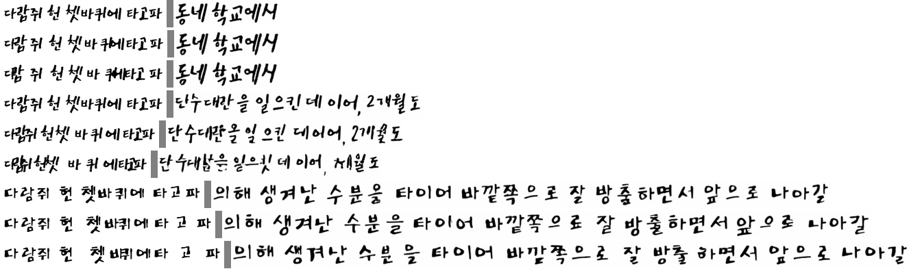
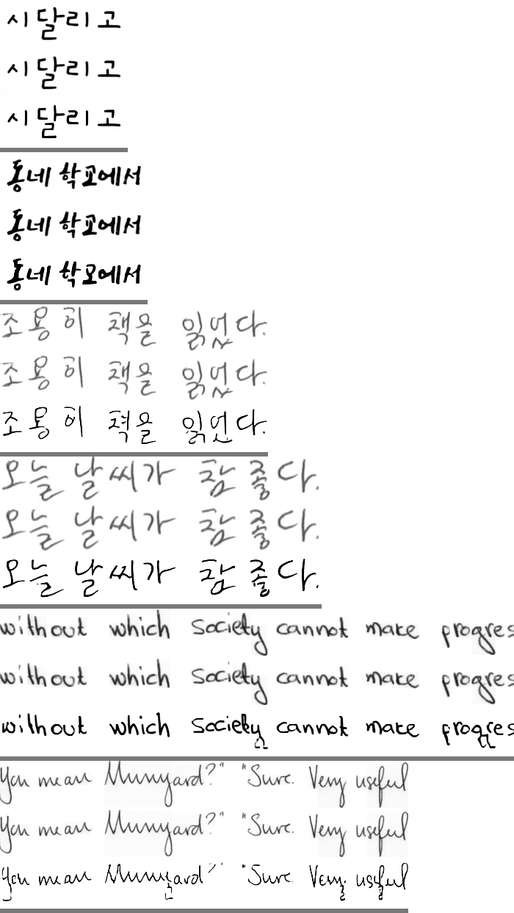
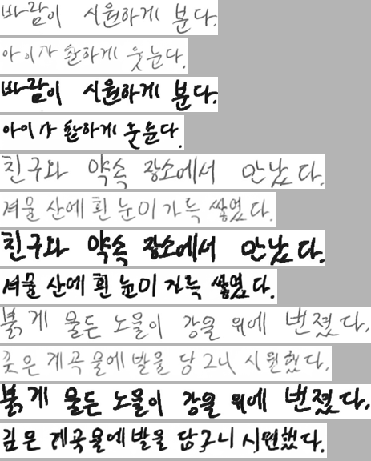

# 실험 로그 — InkSpire 한글 재현

> §1~§4 는 `Eruku_korean_finetuning/docs/EXPERIMENTS.md` §12 에서 옮겼다(2026-09-15). 원본 번호는 버리고 1 부터 다시 매겼다.
> 코드 블록의 `./eval.sh cer` 와 상대경로는 원본 repo 기준이다 — **CER 측정 경로는 원본 repo 에만 있다.**
> `finetune_runs/inkspire_*` 는 이 repo 로 옮겨왔고 `assets`/`data`/`model_zoo` 는 심링크다.
> 구현 상세·진단은 [`inkspire.md`](inkspire.md).

| § | 내용 | 판정 |
|---|---|---|
| 1 | 설정 | |
| 2 | 이미지 모델 FLUX.1-Fill LoRA | 재현 성공 |
| 3 | 레이아웃 모델 | 한 줄 생성엔 std layout 이 낫다 |
| 4 | Eruku 비교 — 자체 HTR | ~~Eruku 압승~~ → 리더 착시(§5) |
| 5 | Eruku 비교 — PP-OCRv6 재측정 | Eruku 0.018 vs InkSpire 0.040 (Eruku 권장 cfg 1.5 면 0.010) |
| 6 | 논문 수치로 본 Eruku 대비 (IAM) | 논문 조건에선 InkSpire 우세 |
| 7 | 이미지 백본 FLUX.3-Image-Klein-Base | CER 0.040 → 0.026 |
| 8 | ref 보강 (inference loop) | 효과 없음 — 접음 |
| 9 | 스타일 지표 (HWD·FID) | 줄 폭 보정(`ref_width`) 후 HWD 는 InkSpire 0.93 < Eruku 0.99(cfg 1.0)~1.12(cfg 1.5). 하한(같은 폰트 다른 문구) 0.34, 폰트별 표 |
| 10 | 실손글씨 (HERIUN/korean-handwriting) — Eruku 추론 설정 정정 포함 | 문장 정확도는 Eruku 압도, HWD·지저분한 ref 견고성은 InkSpire. 원인 = 주로 분포 밖 글자 모양(자간 어긋남은 작음). HWD 하한 hw_line 0.29. 시드 3개: best-of-3 0.275 → 0.169, 폰트엔 없던 일관 오류. **내용 CFG 2.0(재학습 없음) 으로 hw_line CER 0.25 → 0.075** |
| 11 | VAE 비교 (Eruku vs InkSpire) · 획이 날아가는 이유 | VAE 는 병목 아님(Flux2 가 4배 정확). 흐린 획은 ref 농도를 베낀 것 |
| 12 | transformer 정확도 분석 — 오류는 샘플마다 무작위 | 시드 간 같은 글자 오류 0. best-of-3 상한 0.004. → Xc dropout + 내용 CFG 학습 |
| 13 | 결론 | |

논문: *Learning to Generate Stylized Handwritten Text via a Unified Representation of Style, Content, and Noise*
(Wang et al., ICLR 2026, `docs/inkspire.pdf`). 두 단계 분해 p(X, Xc | C, Xs) = p(Xc | C, Xs)·p(X | Xs, Xc) 를 합성 폰트
페이지로 재현한다. 코드: `custom_datasets/korean/page.py` · `models/inkspire.py` · `models/inkspire_klein.py` ·
`models/inkspire_layout.py` · `train/inkspire*.py` · `infer/inkspire.py` · `configs/inkspire*.yaml`.

## 1. 설정

| 항목 | 값 |
|---|---|
| 데이터 | 합성 폰트 페이지(`assets/fonts/train` 12,951종, NanumGothic 제외), line_h U(40,80), P=512 패치, R-Mask |
| 이미지 모델 | FLUX.1-Fill-dev + LoRA r=32/α=32 (115.9M, 논문 표 8 13종), R-APE, 텍스트 인코더 제거(빈 프롬프트 캐시), guidance 30 |
| 이미지 학습 | Prodigy lr 1 wd 0.01, batch 4, grad clip 1.0, 20k step, GPU 2 (H100 96GB). 실측 2.6 s/step → 20k ≈ 14.5h (계획 7~9h 과소) |
| 레이아웃 모델 | masked CFM transformer 10층/512/8h (33M) + line_emb, 정규화 버퍼, 무레퍼런스 모드 10% |
| 레이아웃 학습 | AdamW 1e-4, batch 160, 20k step |
| 추론 | one-shot: ref 한 줄(잉크 48px, pitch 77) + 마스크된 아래 줄, ODE 20 step. 레이아웃 = std layout(표준폰트 bbox) 또는 `--layout-ckpt` |
| 평가 | §4: 자체 HTR CER **중앙값·폭주율**(평균 금지). §5 이후: PP-OCRv6 corpus CER. style-ref = `"다람쥐 헌 쳇바퀴에 타고파"` |

## 2. 이미지 모델 — FLUX.1-Fill LoRA (oracle 레이아웃 val, std layout 평가)

```bash
GPU=2 ./train.sh fetch-flux                                # hf auth login + 라이선스 수락 선행, 34GB
GPU=2 ./train.sh inkspire --out finetune_runs/inkspire_smoke --max-steps 2 --batch-size 1 --P 256 \
    --num-workers 0 --val-every 1 --val-batches 1 --val-steps 2 --save-every 1
GPU=2 ./train.sh inkspire --out finetune_runs/inkspire_p512 --max-steps 2000 --val-every 500 --save-every 500
#   → finetune_runs/inkspire_p512/samples/val_s002000.png 육안 (첫 줄 스타일로 아래 줄에 읽히는 한글?)
GPU=2 ./eval.sh cer --ckpt inkspire:finetune_runs/inkspire_p512/lora_last --n 100 --coherent --binarize 200
GPU=2 ./train.sh inkspire --out finetune_runs/inkspire_p512 --resume finetune_runs/inkspire_p512/lora_step_002000 --max-steps 20000
```

| step | val loss | s/step | peak VRAM | val_s*.png 육안 | 자체 HTR CER 중앙값 (std layout, echo, n=100) |
|---|---|---|---|---|---|
| 500 | 0.193 | 2.6 (B=4, 0.39 it/s) | 30.6GB | ✅ 아래 줄 전부 ref 폰트 스타일로 재현, 숫자·일부 자모 오류 소수 | — |
| 1000 | 0.189 | 2.6 | 30.6GB | one-shot 몽타주(`_debug/inkspire_s1000.png`) 4 writer 전부 스타일 전이, 숫자 약함 | (§4 표 s1000 행) |
| 2000 | 0.184 | 2.6 | 30.6GB | ✅ | — |
| 13000 | 0.171 | 3.9 (GPU 경합) | 30.6GB | ✅ 정답과 거의 구분 불가, 오류는 숫자에 몰림 | **0.190** (n=300, +layout, style-ref) |
| 20000 | 0.168 | 2.5 | 30.6GB | ✅ 동일 | 0.222 (같은 조건) |

★ **val loss 는 끝까지 내려갔지만(0.193 → 0.168) CER 은 13k 가 20k 보다 낫다**(중앙값 0.190 vs 0.222, 폭주율 1.7% vs 2.7%).
손실로 체크포인트를 고르면 안 된다. 전체 평균 0.265 it/s(GPU 경합 포함) → 20k 에 약 21h.

## 3. 레이아웃 모델

```bash
GPU=2 ./train.sh inkspire-layout --out finetune_runs/inkspire_layout_smoke --max-steps 2 --batch-size 4 \
    --num-workers 0 --norm-batches 1 --val-every 1 --val-batches 1
GPU=2 ./train.sh inkspire-layout --out finetune_runs/inkspire_layout                # val_l1_px 하강·정체 확인
```

| step | val loss | 생성 토큰 bbox L1 (px, held-out v2/test) |
|---|---|---|
| 스모크 s2 (batch 4) | 1.31 | 45.2 (미학습 기준값) |
| 2000 | 0.333 | 11.2 |
| 4000 | 0.285 | 11.2 |
| 6000 | 0.261 | 12.8 |
| 8000 | 0.255 | 11.7 |
| 20000 | 미완주 | — |

실측 메모(2026-09-10):
- 첫 배치에서 1,049 토큰 페이지가 `max_len` 1024 를 넘어 크래시 → `KoreanLayoutDataset.MAX_TOKENS` 로 줄 경계 캡, 모델 `max_len` 2048.
- batch 160 × 최대 2,048 토큰이면 attention·FFN 활성화가 **76GB** 까지 감 → MAX_TOKENS 1024 로 캡(초과는 pitch≈42px 극단뿐).
  1024 캡 후에도 이미지 모델과 동시 학습 시 GPU 2 83GB, 이미지 run 속도 0.26→0.11 it/s 로 반토막 → 레이아웃은 s8000 에서 중단.
- 속도 0.94 it/s(단독) → 20k 는 6h. 계획의 "40분"은 페이지 렌더 병목을 과소평가한 것. bbox L1 은 s2000 부터 11~12px 정체(val loss 는 계속 하강) — 20k 가 필요한지는 의문.
- 추론 관찰: 줄 시작 Δx(= −이전 줄 폭)를 가장 못 맞춰 줄이 오른쪽으로 밀림(학습 줄은 page_w 를 채우지만 추론 줄은 짧음)
  → `infer/inkspire.py` 에서 줄마다 첫 토큰을 좌측 여백으로 평행이동(학습 페이지는 전부 좌측 시작). 크기·간격은 예측값 유지.
- 진단(2026-10, `inkspire.md` §9.4): 짧은 단독 줄의 첫 글자 오차 142px 가 원인. 긴 줄 아래 3번째 줄로 쓰게 하면 반듯하다.

## 4. Eruku 비교 — 자체 HTR (n=300, coherent, binarize 200, seed 0)

> ★ **2026-10-20 정정:** 이 절의 자체 HTR(`aux_htr_ko/htr_s20000`)은 같은 폰트 렌더로 학습된 리더라 InkSpire 출력을 과하게 나쁘게 읽었다.
> 판정은 §5 를 따른다. 이 표는 레이아웃 모델 기여(std layout vs +layout)를 가르는 용도로만 남긴다.

```bash
BEST=finetune_runs/eruku_corpusmax/checkpoint_last.pth
INK=inkspire:finetune_runs/inkspire_p512/lora_last,finetune_runs/inkspire_layout/checkpoint_last.pth
for F in assets/fonts/ref assets/fonts/test assets/custom_hw_fonts; do for CK in $BEST $INK; do
  GPU=2 ./eval.sh cer --ckpt $CK --fonts-dir $F --n 300 --coherent --binarize 200 --seed 0 \
      --style-ref-text "다람쥐 헌 쳇바퀴에 타고파" --out finetune_runs/_eval/inkspire_$(basename $F)_${CK%%:*}_sref.txt
  GPU=2 ./eval.sh cer --ckpt $CK --fonts-dir $F --n 300 --coherent --binarize 200 --seed 0 \
      --out finetune_runs/_eval/inkspire_$(basename $F)_${CK%%:*}_echo.txt
done; done
```

| 세트 | 모델 | 프로토콜 | 평균 | 중앙값 | 폭주율 | GT 바닥 |
|---|---|---|---|---|---|---|
| seen v2/train | Eruku corpusmax s45000 | echo | 0.085 | 0.000 | 0.3% | 0.005 |
| seen v2/train | Eruku corpusmax s45000 | style-ref | 0.083 | 0.000 | 0.0% | 0.005 |
| seen v2/train | InkSpire s20000 std layout | echo | 0.247 | 0.102 | 3.0% | 0.005 |
| seen v2/train | InkSpire s20000 std layout | style-ref | 0.225 | 0.095 | 2.0% | 0.005 |
| seen v2/train | InkSpire s20000 + layout | echo | 0.325 | 0.200 | 2.7% | 0.005 |
| seen v2/train | InkSpire s20000 + layout | style-ref | 0.330 | 0.143 | 1.7% | 0.005 |
| held-out v2/test | Eruku corpusmax s45000 | echo | 0.123 | 0.029 | 0.3% | 0.026 |
| held-out v2/test | Eruku corpusmax s45000 | style-ref | 0.064 | 0.000 | 0.0% | 0.026 |
| held-out v2/test | InkSpire s20000 std layout | echo | 0.353 | 0.250 | 5.0% | 0.026 |
| held-out v2/test | InkSpire s20000 std layout | style-ref | 0.278 | 0.197 | 2.3% | 0.026 |
| held-out v2/test | InkSpire s20000 + layout | echo | 0.345 | 0.254 | 1.3% | 0.026 |
| held-out v2/test | InkSpire s20000 + layout | style-ref | 0.368 | 0.222 | 2.7% | 0.026 |
| held-out v2/test | InkSpire **s13000** + layout (최적 체크포인트) | style-ref | 0.324 | 0.190 | 1.7% | 0.026 |
| custom_hw 4 | Eruku corpusmax s45000 | echo | 0.198 | 0.056 | 0.0% | 0.209 |
| custom_hw 4 | Eruku corpusmax s45000 | style-ref | 0.083 | 0.000 | 0.0% | 0.209 |
| custom_hw 4 | InkSpire s20000 std layout | echo | 0.419 | 0.300 | 5.7% | 0.209 |
| custom_hw 4 | InkSpire s20000 std layout | style-ref | 0.346 | 0.226 | 3.3% | 0.209 |
| custom_hw 4 | InkSpire s20000 + layout | echo | 0.422 | 0.333 | 2.3% | 0.209 |
| custom_hw 4 | InkSpire s20000 + layout | style-ref | 0.384 | 0.253 | 2.3% | 0.209 |

이 리더로 본 관찰 (리더 착시를 걷어내도 방향이 유지되는 것만):
1. **레이아웃 모델이 오히려 손해다.** 6 개 비교쌍 전부 std layout 이 같거나 낫다(held-out style-ref 0.197 vs 0.222).
   단 한 줄씩 생성하는 이 프로토콜에서만 — §3 진단 참고.
2. **체크포인트 선택이 손실과 어긋난다.** val loss 최저는 s20000 이지만 CER 최저는 s13000.
3. ~~굵은 폰트 약점(BagelFatOne 0.423)~~ 은 리더 착시. 붓글씨류(NanumBrushScript) 약점과 숫자 오류는 §5 에서도 남는다.

몽타주: `finetune_runs/inkspire_p512/_eval/`(s20000 + 레이아웃), `_eval_best/`(s13000 + std layout),
`_eval_pangram/`(held-out 폰트 + 한글 pangram ref, `experiments/gencmp_split.py`) — 마지막이 공정한 조건이고 육안으로 Eruku 와 엇비슷하다.

## 5. Eruku 비교 — PP-OCRv6 재측정 (2026-10-20)

> ★ **2026-10-23 정정:** 이 절~§9 의 Eruku 는 **cfg 1.0 · 옛 디코딩**이다(§10 첫 표). 새 디코딩 + 권장 cfg 1.5 로 같은 표본을 다시 재면
> Eruku CER **0.010**(한글 0.8%, 숫자 1.9%, 기호 5.8%), HWD 1.117, FID 26.8 — cfg 1.0 새 디코딩은 0.018 / HWD 1.007 로 옛 것과 같다
> (디코딩 변경은 ref 전사를 줄 때 영향 없음). 결과 `finetune_runs/_cer/eruku_ctx_cfg{1.0,1.5}`.

독립 리더 PP-OCRv6(`HERIUN/PP-OCRv6-medium-rec-ko-printed-handwriting`, 원본 repo `.venv-paddle`). §4 와 같은 표본
(held-out 16폰트, style-ref pangram, coherent, n=300, seed 0). 경로는 `experiments/cer_dump.py` docstring:
`plan`(원본 repo env) → `gen`(여기) → `eval/ppocr_rec.py --save-preds`(원본 repo). 결과 `finetune_runs/_cer/*`. 분해·해석은 `inkspire.md` §9.6.

| 조건 | 자체 HTR 중앙값 | PP corpus CER | PP 평균 / 중앙값 | 한글 | 숫자 | 기호 |
|---|---|---|---|---|---|---|
| GT 렌더 (리더 바닥) | 0.026 | 0.006 | 0.005 / 0 | | | |
| Eruku corpusmax s45000 | 0.000 | **0.018** | 0.021 / 0 | 1.9% | 2.5% | 2.7% |
| InkSpire s13000 std layout | 0.190 | 0.040 | 0.045 / 0 | 3.5% | 12.7% | 8.9% |
| + `tight_mask` | — | 0.034 (부호검정 p=0.33) | 0.043 / 0 | 2.8% | 7.0% | 8.9% |
| + 전사 없음 (`--style-text none`) | — | 0.720 (134/300 백지) | 0.759 / 1.0 | 75.6% | 62.7% | 78.1% |
| + Xc 첫 줄에 목표 텍스트 | — | 0.355 | 0.466 / 0.409 | 40.3% | 33.5% | 40.2% |
| + Xc 첫 줄에 ref 의 PP-OCR 판독 | — | 0.041 | 0.046 / 0 | 3.6% | 12.0% | 8.9% |

- 자체 HTR 중앙값 0.190 → PP 중앙값 0. "크게 진다"는 리더 착시였지만 **corpus CER 은 여전히 Eruku 가 2배 낫다.**
- 격차는 숫자·기호·붓/펜글씨와 한글 중성(모음 짧은 획)에 몰린다.
- **ref 전사가 필수다.** 이미지 모델이 Xc ref 줄을 글자별 대응표로 쓴다 — 비우면 붕괴, 목표 텍스트로 채우면 ref 글자 모양이 섞인다.

## 6. 논문 수치로 본 Eruku 대비 (IAM Lines, 2026-10-22)

InkSpire 논문 표 2 에 Eruku/Emuru 행은 없지만 **baseline 4행이 Eruku 논문(arXiv 2510.23240, WACV 2026) 표 3 IAM Lines 와 숫자까지 같다**
(HWT FID 44.72 / HWD 2.97 / ΔCER 0.33, One-DM 43.89 / 2.83 / 0.13, DiffPen 12.89 / 2.13 / 0.03,
InkSpire 의 "VATr" 34.00 / 2.38 / 0.03 = Eruku 표의 **VATr++** 행). 같은 Pippi et al. 평가 프로토콜 수치를 옮겨 쓴 것이라 한 표로 이을 수 있다.

| IAM Lines | FID↓ | HWD↓ | ΔCER↓ | IAM 학습 |
|---|---|---|---|---|
| DiffPen | 12.89 | 2.13 | 0.03 | ✓ |
| Emuru | 13.89 | 1.87 | 0.14 | ✗ (zero-shot) |
| Eruku (γ=1.25) | 16.40 | 1.70 | 0.06 | ✗ (zero-shot) |
| **InkSpire** | **7.92** | **0.62** | **0.01** | ✓ |
| Eruku 한글 파인튜닝 (측정, 원본 `eval/iam_shtg.py` ours, γ=1.25, w/ T_s) | 20.00 | 1.62 | −0.03 | ✗ |
| InkSpire 한글 (이 repo, 측정 2026-10-26, 같은 채점기·같은 ref) | 18.58 | 1.68 | 0.33 | ✗ (zero-shot) |

- **논문 조건에서는 InkSpire 가 전 지표 우세**, 특히 HWD(스타일) 0.62 vs 1.70 로 차이가 크다.
- **같은 IAM 을 우리 두 한글 모델로 직접 재면(전체 2,925줄, `experiments/iam_dump.py`) InkSpire 의 우세는 사라진다** — HWD 1.68 vs 1.62, FID 18.58 vs 20.00 로 비슷하고
  ΔCER 0.33 vs −0.03, BFID 15.41 vs 4.73 로 Eruku 가 앞선다. 논문 InkSpire 의 우세는 IAM 학습 + 글자 bbox 주석에서 온다. 결과 `finetune_runs/_iam/inkspire_klein_lines`.
- 단 조건이 다르다: (a) InkSpire 는 IAM 으로 학습, Eruku 는 IAM 미학습(zero-shot). (b) InkSpire 는 ref 의 전사 + 글자 bbox 정답 주석을 받는다.
  (c) InkSpire 의 IAM 추론은 같은 writer 의 둘째 줄로 첫 줄을, 첫 줄로 나머지를 만든다(논문 §4.3) — 같은 문단의 실제 줄이 ref 다.
- 우리 한글 재현(§5)과 방향이 반대인 이유 후보: 학습 분포 안(IAM seen) vs 밖(held-out 폰트), FID/HWD 는 스타일 지표이고 우리는 CER 만 쟀다,
  P=1024 vs 512. 한글 HWD 비교는 §9 — 한글 조건에선 Eruku 가 앞선다.

## 7. 이미지 백본 FLUX.3-Image-Klein-Base — `black-forest-labs/flux-3-image-klein-base` (2026-10-21~)

HF [`black-forest-labs/flux-3-image-klein-base`](https://huggingface.co/black-forest-labs/flux-3-image-klein-base)(FLUX.3-Image-Klein-Base, 5.54B, 게이트 repo · 비상업 라이선스)에
같은 LoRA 학습을 얹는다. `train/inkspire.py --backbone klein`, 모듈 `models/inkspire_klein.py`(models/inkspire.py 와 같은 API).
`infer/inkspire.py backbone()` 이 LoRA 키(`mode_blocks`)로 FLUX.3-Image-Klein-Base 를 자동 판별하므로 `cer_dump.py`·`show` 는 그대로 쓴다.

| 항목 | FLUX.1-Fill-dev (§2) | FLUX.3-Image-Klein-Base |
|---|---|---|
| 조건 주입 | 채널 concat (X·(1−M), M, Xc) | 별도 `image_cond` 스트림(timestep 0): cond1 = X·(1−M)(마스크 영역 회색, l=−1), cond2 = Xc (l=−2) |
| 위치 | R-APE (회전) | 생성·조건 토큰이 같은 (h, w) id → **APE 가 기본 구조**. 회전 없음 |
| 텍스트 인코더 | 빈 프롬프트 캐시 | Qwen3-VL-4B 빈 프롬프트 캐시(`model_zoo/klein_empty_prompt.pt`) |
| 샘플링 | guidance 30 | shift 6.93, guidance 임베딩 없음(CFG 미사용). 매 step 비마스크 토큰을 (1−σ)x0+σz 로 덮어씀 |
| LoRA | r32, 115.9M | r32, 71.2M (image/image_cond mode 블록 + single 블록 attn·ff, x_embedders) |
| 학습 | 2.6 s/step, 30.6GB | 0.27 it/s(GPU 경합), 18GB, 13k step ≈ 13h |

**VAE 상한(`experiments/vae_recon.py`, GT 렌더 왕복, PP corpus CER, n=300):** VAE 는 병목이 아니다 — 둘 다 GT 와 같다.

| | GT | FLUX.1-Fill-dev VAE | FLUX.3-Image-Klein-Base VAE (AutoencoderKLFlux2) |
|---|---|---|---|
| 줄높이 64 | 0.0056 | 0.0061 | 0.0062 |
| 줄높이 32 | — | 0.0079 | 0.0079 |

환경: `Flux3Transformer2DModel` 때문에 diffusers git main(0.42.0.dev0) + transformers 5.20.2 로 올렸다. FLUX.1 출력은 bf16 잡음 수준(평균 0.5/255)만 바뀐다.

**학습** (`finetune_runs/inkspire_klein_p512`, P=512 batch 4 Prodigy, §2 와 같은 데이터·마스크):

| step | 500 | 2000 | 6000 | 10000 | 13000 |
|---|---|---|---|---|---|
| val loss | 0.119 | 0.106 | 0.097 | 0.094 | 0.092 |

latent 공간이 달라 FLUX.1 val loss 와 직접 비교 불가. s500 부터 4폰트 모두 스타일 재현, 남는 오류는 FLUX.1 과 같은 유형(모음 짧은 획·숫자:
"컬럼비아→걸럼비아", "210,679→210,6D9").

**평가 (§5 와 같은 표본·리더):**

| 조건 | PP corpus CER | PP 평균 / 중앙값 | 한글 | 숫자 | 기호 |
|---|---|---|---|---|---|
| FLUX.1-Fill-dev s13000 (§5) | 0.040 | 0.045 / 0 | 3.5% | 12.7% | 8.9% |
| FLUX.3-Image-Klein-Base s6000 | 0.039 | 0.049 / 0 | 4.2% | 1.9% | 3.6% |
| FLUX.3-Image-Klein-Base s13000 | **0.026** | 0.028 / 0 | 2.5% | 4.4% | 1.3% |
| (참고) Eruku corpusmax s45000 (§5) | 0.018 | 0.021 / 0 | 1.9% | 2.5% | 2.7% |

결과 `finetune_runs/_cer/klein_s{006000,013000}_test_sref`, 분해 `experiments/cer_analyze.py`. 폭주율 0%, GT 바닥 0.0056.

- **같은 step 수(13k)에서 FLUX.1-Fill-dev 대비 CER 0.040 → 0.026(−35%).** 개선은 숫자(12.7 → 4.4%)·기호(8.9 → 1.3%)·라틴(23.5 → 0%)에
  몰렸다 — FLUX.1 의 약점 그대로였던 곳. 기호는 Eruku(2.7%)보다 낫다.
- **한글은 3.5 → 2.5% 로 Eruku(1.9%)와 아직 격차.** 틀린 자모는 여전히 중성 41%(원→윈, 중→증, 로→르) — 모음 짧은 획 약점은 백본을 바꿔도 남는다.
- 폰트별: 붓·펜글씨가 크게 좋아졌다(NanumBrushScript 0.173 → 0.029, NanumPenScript 0.053 → 0.028). 대신 EastSeaDokdo 0.026 → 0.077,
  Dongle·BlackHanSans 0 → 0.03~0.04 로 나빠졌다(폰트당 n=11~29 라 잡음 폭 큼).
- s6000 → s13000 에 0.039 → 0.026 으로 내려가서 20k 까지 연장했다(resume, Prodigy 상태 복원) → **20k 는 나빠진다** — 아래.

**20k 연장 (2026-10-23, `ref_width` 켬, 같은 표본):** val loss 는 13k 이후 0.092 로 평평. 두 백본 모두 20k 가 13k 보다 **유의하게 나쁘다.**

| | 13k CER | 20k CER | 20k vs 13k 표본별 나음 / 나쁨 | HWD 13k → 20k |
|---|---|---|---|---|
| FLUX.3-Image-Klein-Base | **0.023** | 0.034 | 30 / 71 (p<0.001) | 0.929 → 0.909 |
| FLUX.1-Fill-dev | 0.026 | 0.038 | 34 / 70 (p<0.001) | 0.905 → 0.852 |

20k 에서 한글이 1.9 → 3.1%(Klein), 2.1 → 3.1%(FLUX.1) 로 나빠지고 HWD 는 조금 좋아진다 — 필체를 더 닮는 대신 획이 흐트러진다.
FLUX.1 에서 자체 HTR 로 본 "13k > 20k"(§2)는 리더 착시가 아니었다. **최종 체크포인트는 두 백본 모두 13k.**

## 8. ref 보강 — inference loop (2026-10-22)

### 왜

ref 는 한 줄("다람쥐 헌 쳇바퀴에 타고파", 11음절)뿐이라 목표 글자 대부분은 ref 에 없다. 가설: **ref 에 없는 글자라서 스타일 복제가
약하다.** 그렇다면 목표를 만들기 전에 보강 줄을 하나 더 깔아 필체 예시를 늘리면 나아질 것이다. 실사용에서 보강 줄은 모델이
먼저 생성한 결과로 만든다(반복 추론 = inference loop).

기존 결과가 가설을 지지했다 — FLUX.3-Image-Klein-Base s13000 에서 ref 에 **있는** 음절은 0.5%, **없는** 음절은 2.6% 틀린다(5배).
단 Eruku 도 0.3% vs 2.0% 로 같은 경향이라, ref 음절이 원래 쉬운 글자라서 생긴 차이가 섞여 있을 수 있었다.

### 무엇을 했나

`InkSpireGen.prepare(..., ctx=[(이미지, 전사[, 글자 x 상자])])` 로 ref 아래에 보이는 줄을 추가하고 목표 줄을 그만큼 내린다
(ctx 없으면 HEAD 와 픽셀 동일 확인). 실행은 `experiments/cer_dump.py gen --ctx {fixed,adapt} --ctx-src {oracle,boot}`.
보강 줄을 두 축으로 나눠 2×2 조건을 돌렸다.

| | 보강 줄 내용 |
|---|---|
| **fixed** | 목표와 무관한 고정 문장 `2024년 1~3월 원로 중 57.8%는 '꿈'을 이뤘다?! (69)` — 숫자 10종·기호·중성 오류 잦은 음절(원·로·중·는) |
| **adapt** | 목표 음절 중 ref 에 없는 것(등장 순, 중복·공백 제거). 예: "3억원이 전달된 혐의를…" → `3억원이전달된혐의를…` |

| | 보강 줄 이미지 | 의미 |
|---|---|---|
| **oracle** | 그 폰트로 렌더한 진짜 필체 + 진짜 글자 x 상자 | 실사용 불가. 보강이 완벽할 때의 **상한** |
| **boot** | 모델이 ref 만 보고 먼저 생성한 것 | 실사용 가능한 inference loop |


모델 입력 [X | Xc | 마스크(검정=생성)]. 위 = 기준선, 가운데 = adapt-boot, 아래 = fixed-oracle.
캔버스 폭은 목표 줄에 맞춰 자르므로(§2 `trim_ref`, 빈 공간 생성 방지) 긴 보강 줄은 목표 폭에서 잘린다.

**기대:** oracle 은 기준선보다 확실히 낫고(특히 ref 에 없는 음절·숫자), boot 는 그 사이.
oracle 조차 효과가 없으면 이 방향은 접는다(사전 결정).

### 중간에 발견한 것 — X↔Xc 상자 어긋남

처음 oracle 은 보강 줄의 Xc 상자를 ref 처럼 **표준폰트 bbox 를 줄 폭에 맞춰 늘린 근사**로 줬는데, 기준선보다 나빴다(adapt 0.036, fixed 0.047).
진짜 필체는 글자 폭이 표준폰트와 달라 상자가 어긋난다:

| 줄 | 평균 중심 어긋남 | 반 글자 이상 어긋난 글자 |
|---|---|---|
| ref | 0.05 글자폭 | 0% |
| adapt 보강 줄 | 0.08 | 2.1% |
| fixed 보강 줄 (숫자·기호) | 0.22 | **10.4%** |


어긋난 짝을 모델이 대응표로 배워 이웃 글자 오류("흘러내리다 → 흘러대리다")를 냈다. boot 는 생성이 처음부터 표준폰트 상자에 맞춰
그려지므로 어긋남이 없다. → oracle 에 진짜 글자 x 상자(`render_line` 이 주는 것 = 논문의 GT 레이아웃 자리)를 주고 다시 쟀다.
**교훈: 보이는 줄을 추가할 때는 X↔Xc 짝이 정확해야 한다 — 어긋나면 안 넣느니만 못하다.**

### 결과 (FLUX.3-Image-Klein-Base s13000, held-out 16폰트, n=300, PP-OCRv6, 시드 1개)

| 조건 | CER | 한글 | 숫자 | 기호 | 짧은 목표(≤8자) | 긴 목표 | 기준선 대비 표본별 나음/나쁨 | 부호검정 p |
|---|---|---|---|---|---|---|---|---|
| 기준선 (§7) | 0.026 | 2.5% | 4.4% | 1.3% | 0.033 | 0.025 | — | — |
| adapt-oracle | 0.024 | 2.2% | 2.5% | 4.5% | 0.019 | 0.024 | 58 / 53 | 0.64 |
| adapt-boot | 0.021 | 1.8% | 2.5% | 3.1% | 0.047 | 0.020 | 60 / 57 | 0.78 |
| fixed-oracle | 0.034 | 3.2% | 2.5% | 6.7% | 0.049 | 0.033 | 55 / **88** | **0.006** |
| fixed-boot | 0.028 | 2.6% | **0.6%** | 6.2% | 0.044 | 0.027 | 51 / 65 | 0.19 |
| (상자 근사) adapt / fixed-oracle | 0.036 / 0.047 | | | | | | 57/73 · 38/114 | 0.16 · <0.001 |

결과 `finetune_runs/_cer/klein_s013000_ctx_*` (근사 상자판은 `*_oracle_stdbox`). 각 덤프의 `ctx/` 에 보강 줄 이미지.


조건 간 CER 차이가 큰 8표본(차이 큰 것만 골라 실제보다 극적으로 보인다). 보강 줄이 있는 셀은 회색 선 위 = 보강 줄, 아래 = 최종 생성.
fixed 열의 보강 줄은 전체 문장을 한 셀에 넣느라 작게 보일 뿐, 실제 입력에선 목표 폭에서 잘린다.

1. **상한(oracle)이 기준선과 같다.** 목표 글자의 진짜 필체·진짜 상자를 줘도 adapt-oracle 58 나음 / 53 나쁨. 그림에서 보듯 모델은
   보강 줄의 같은 글자를 **베끼고**, 진짜 필체를 베끼면 맞게 나오지만(00285 "제1야당", 00080 "되돌아가다") 원래 맞던 표본이
   새로 틀리는 경우도 비슷하게 많다.
2. **boot 는 1차 생성의 복사다.** 00285 1차 "제L야당" → 최종 "제L야당", 00109 "임무시겨인" 그대로. 최종 = 시드만 다른 1차 생성이므로
   새 정보가 없다. corpus 0.021 은 표본별로 60 / 57(p=0.78) — 긴 문장 몇 개가 만든 잡음이다.
3. **fixed 는 유의하게 손해다**(oracle p=0.006). 숫자는 좋아지지만(4.4 → 0.6~2.5%) 기호가 1.3 → 6~7% 로 나빠진다 —
   보강 줄의 따옴표·괄호·% 모양이 목표의 다른 기호로 번지는 것으로 보인다. 목표와 겹치는 글자가 없으니 베낄 것도 없다.
4. **처음 가설이 틀린 이유:** "ref 에 있는 음절 0.5% vs 없는 음절 2.6%" 는 대부분 ref 음절이 쉬워서였다(oracle 로 확인).
   남은 오류는 모음 짧은 획 같은 **획 정확도**이지 예시 커버리지가 아니다.

**판정: 접는다.** 한계 — 시드 1개. 캔버스 높이가 바뀌면 같은 시드라도 노이즈가 달라 표본의 ~1/3 이 조건과 무관하게 흔들린다.
20% 수준 효과를 가리려면 시드 3개쯤 필요하지만 상한에서 신호가 없어 그 비용을 쓸 근거가 없다. 코드(`ctx`)는 기본값이 꺼져 있어 남겨 둔다
— 다줄·문단 생성(보이는 줄이 여러 개인 캔버스)에 그대로 쓸 수 있다.

재현:
```bash
I=/data/work/dgkang/inkspire_korean; E=/data/work/dgkang/Eruku_korean_finetuning
O=$I/finetune_runs/_cer/klein_s013000_ctx_adapt_boot; mkdir -p $O; cp $I/finetune_runs/_cer/s13000_test_sref/plan.json $O/
cd $I && CUDA_VISIBLE_DEVICES=2 PYTHONPATH=$I .venv/bin/python experiments/cer_dump.py gen $O \
    --ckpt inkspire:finetune_runs/inkspire_klein_p512/lora_step_013000 --ctx adapt --ctx-src boot
cd $E && .venv-paddle/bin/python eval/ppocr_rec.py $O/gen --save-preds
python docs/_gen_inkspire_ctx.py      # 그림 14~16 (추론 없음, 덤프만 읽는다)
```

## 9. 스타일 지표 — HWD · FID · BFID · KID (2026-10-22)

### 왜

§6 에서 논문 IAM 수치로는 InkSpire 가 스타일(HWD 0.62 vs Eruku 1.70)에서 크게 앞섰고, §10 결론은 "InkSpire 를 다시 꺼낼 근거는
CER 이 아니라 스타일"이었다. 한글에서도 그런지 잰다.

### 어떻게

`experiments/style_scores.py` — 원본 repo `.venv` 의 `hwd` 패키지(Eruku 논문 표 3 과 같은 구현, 높이 32). 추론 없이 §5·§7 의 덤프를 읽는다.
real = 같은 표본의 GT 렌더, fake = 각 모델 출력, 폴더명 = 폰트(필기자) → HWD 는 폰트별 VGG16 특징 거리의 평균.
하한 기준으로 **std-font**(목표 텍스트를 표준폰트 NanumGothic 으로 렌더 = 스타일 복제 0)를 같이 잰다.

★ **정규화 필수.** 덤프마다 위아래 여백(GT 30% / InkSpire 17% / Eruku 20%)과 배경(InkSpire 249~251, 나머지 255)이 달라
높이 32 로 줄이면 글자 크기·밝기 차이를 FID 가 잡는다 — 정규화 전에는 InkSpire FID(57.7)가 std-font(59.7)와 비슷했다.
모든 이미지(real 포함)를 배경 → 255, 잉크 bbox 크롭, 잉크 높이 15% 여백으로 맞춘다(기본, `--raw` 로 끔).

### 결과 (held-out 16폰트, n=300, 정규화)

| | HWD↓ | FID↓ | BFID↓ | KID↓ | 출력 폭 vs GT (중앙값) |
|---|---|---|---|---|---|
| FLUX.3-Image-Klein-Base s13000 | 1.338 | 45.7 | 24.0 | 0.021 | +23% |
| **FLUX.3-Image-Klein-Base s13000 + `ref_width`** | **0.929** | 37.3 | 16.2 | 0.014 | **7%** |
| FLUX.1-Fill-dev s13000 | 1.306 | 48.2 | 22.3 | 0.024 | +22% |
| **Eruku s45000** | **0.989** | **26.0** | **15.7** | **0.003** | **7%** |
| std-font (스타일 복제 0) | 3.281 | 60.1 | 45.3 | 0.030 | +18% |

결과 `finetune_runs/_cer/style_scores.json`. 정규화 전(`--raw`): HWD 1.58 / 1.54 / 1.35 / 3.40, FID 57.7 / 61.6 / 34.8 / 59.7 (같은 순서).

1. **한글 합성 폰트 조건에서는 스타일도 Eruku 가 앞선다.** 논문 IAM(§6)과 방향이 반대다. 두 InkSpire 백본은 서로 비슷하다 —
   FLUX.3-Image-Klein-Base 는 CER 만 좋아졌고 스타일은 그대로다.
2. **원인 후보: 줄 기하가 표준폰트를 따른다.** std layout 은 목표 줄 글자 상자를 NanumGothic 그대로 두므로 InkSpire 출력의 줄 폭은
   GT 보다 22~23% 넓다 — 스타일 복제 0 인 std-font(18%)보다도 멀다. Eruku 는 자간·글자 폭까지 생성해 7% 다. 글자 모양은 필체를
   닮아도 줄 모양이 NanumGothic 이다. 논문은 이 자리에 레이아웃 모델을 쓰고(§3, 우리는 한 줄 생성에서 CER 손해) IAM 은 GT 레이아웃이 있다.
3. **재학습 없는 보정 `ref_width` 로 줄 폭을 맞추면 HWD 가 Eruku 를 넘는다.** ref 줄은 이미 "손글씨 폭 / 표준폰트 폭" 비율을
   안다(ref 상자를 그 비율로 늘리고 있었다). 같은 비율을 목표 줄 상자 x 에도 곱한다 — `InkSpireGen(ref_width=True)` /
   `inkspire:<lora>,ref_width=1`. **2026-10-22 부터 기본값 켬** — §2~§8 의 수치는 꺼진 상태(재현은 `,ref_width=0`). 출력 폭 오차 23% → 7%(Eruku 와 같음), **HWD 1.338 → 0.929(Eruku 0.989)**, FID 45.7 → 37.3,
   BFID 24.0 → 16.2(Eruku 15.7). FID·KID 는 여전히 Eruku 가 낫다.
   **CER 은 그대로** — 0.026 → 0.023, 표본별 54 나음 / 50 나쁨(p=0.70). 결과 `finetune_runs/_cer/klein_s013000_refwidth`.


무작위 10표본(`experiments/montage.py --seed 3`). 가운데 두 열 = 기준선 / `ref_width`. 00184 "두리번거리다", 00244 "불완전하다" 처럼
기준선은 자간이 표준폰트만큼 벌어지고, `ref_width` 는 GT 처럼 붙는다.

**`ref_width` 는 CER 도 올린다 — FLUX.1-Fill-dev 에서 크게** (2026-10-23, 결과 `finetune_runs/_cer/{flux1,klein}_s0*_rw`):

| ref_width 켬 | CER | 한글 | 숫자 | 기호 | HWD | FID | BFID |
|---|---|---|---|---|---|---|---|
| FLUX.3-Image-Klein-Base s13000 | **0.023** (끔 0.026, p=0.70) | 1.9% | 3.2% | 2.2% | 0.929 | 37.3 | 16.2 |
| FLUX.1-Fill-dev s13000 | 0.026 (끔 0.040, **83 / 51, p=0.006**) | 2.1% | 11.4% | 8.9% | 0.905 | 37.5 | 16.0 |
| Eruku s45000 (cfg 1.0, 옛 디코딩) | 0.018 | 1.9% | 2.5% | 2.7% | 0.989 | **26.0** | **15.7** |
| **Eruku s45000 (권장 cfg 1.5, 새 디코딩, §10)** | **0.010** | **0.8%** | **1.9%** | 5.8% | 1.117 | 26.8 | 16.2 |

FLUX.1 은 표준폰트 자간 캔버스(학습 분포 밖 — 학습 Xc 상자는 늘 그 폰트의 실제 자간)에 약했던 것이고, 그 몫이 한글 3.5 → 2.1% 로 풀렸다.
남은 FLUX.1 약점은 숫자·기호·라틴(학습 한계) — 거기서 FLUX.3-Image-Klein-Base 가 낫다. Eruku 는 여전히 CER 에서 유의하게 앞선다
(Klein s13000 rw 대비 표본별 79 / 32, p<0.001). 스타일은 HWD 는 InkSpire, FID·KID 는 Eruku.

한계: 비율은 ref 한 줄 전체의 평균이라 글자별 폭 차이(예: 숫자·라틴만 좁은 폰트)는 못 맞춘다 — 그건 레이아웃 모델의 몫이다.
GT 가 폰트 렌더라 "줄 폭 = 폰트 고유 자간" 이 정확히 정해진 조건이다. 실손글씨는 줄마다 자간이 흔들려 이득이 줄 수 있다.

### HWD 하한 — 폰트별 (2026-10-28, `experiments/style_floor.py font`)

std-font 는 상한(스타일 복제 0)이고, 하한 = **같은 폰트로 다른 문구**를 같은 표본 수만큼 렌더해 GT 와 잰 HWD(같은 사람이 다른 글을 쓴 거리).
같은 문구 재렌더 = 0.000 으로 렌더 경로가 GT 와 같음을 확인했다. 모델은 FLUX.3-Image-Klein-Base s13000 + `ref_width`, Eruku cfg 1.5 새 디코딩.

| 폰트 | n | 하한 | InkSpire | Eruku | std-font |
|---|---|---|---|---|---|
| NanumBrushScript | 24 | 0.198 | 1.493 | **1.361** | 3.590 |
| Dokdo | 29 | 0.210 | **1.256** | 1.862 | 4.128 |
| Gaegu | 22 | 0.277 | 1.138 | **0.917** | 3.609 |
| Youth | 24 | 0.285 | **0.458** | 0.542 | 1.561 |
| DoHyeon | 13 | 0.289 | **0.938** | 1.543 | 2.421 |
| SongMyung | 19 | 0.293 | **0.624** | 0.735 | 3.134 |
| BlackHanSans | 15 | 0.295 | **0.669** | 1.473 | 3.426 |
| KirangHaerang | 21 | 0.335 | **1.091** | 1.105 | 3.359 |
| NanumPenScript | 21 | 0.341 | 1.309 | **1.060** | 3.877 |
| BagelFatOne | 11 | 0.361 | **0.714** | 1.501 | 3.524 |
| CuteFont | 17 | 0.368 | **0.772** | 1.044 | 3.985 |
| EastSeaDokdo | 17 | 0.371 | **0.835** | 1.129 | 3.986 |
| GowunBatang | 20 | 0.392 | 0.816 | **0.589** | 1.248 |
| HiMelody | 15 | 0.445 | **0.986** | 1.182 | 3.490 |
| Sunflower | 13 | 0.468 | **0.670** | 0.890 | 2.888 |
| Dongle | 19 | 0.481 | 1.100 | **0.943** | 4.277 |
| **평균** | 300 | **0.338** | **0.929** | 1.117 | 3.281 |

- 하한 0.34(폰트별 0.20~0.48). [하한, 상한] 을 0~1 로 보면 InkSpire 0.20 / Eruku 0.27 — 둘 다 하한까지 0.6 이상 남았다.
- 폰트별 InkSpire 11 / Eruku 5 승. InkSpire 는 굵은 디스플레이체(BlackHanSans·BagelFatOne·DoHyeon), Eruku 는 붓·펜 손글씨체
  (NanumBrushScript·NanumPenScript·Gaegu)와 가는 명조(GowunBatang)에서 낫다. InkSpire 가 하한에서 가장 먼 것도 붓·펜체(+0.97~1.30).
- ★ 측정 함정: 폰트 안에서 GT 를 한 칸 밀어 fake 로 쓰면 같은 이미지 집합이라 평균 특징이 같아 0 이 나온다.
  split-half(폰트별 GT 짝/홀 절반끼리)는 0.541 — 절반 n 의 표본 잡음만큼 높다. 실손글씨 하한(§10)은 이 방식이라 그만큼 감안해서 읽는다.
결과 `finetune_runs/_cer/style_floor_{font,split}.json`.

## 10. 실손글씨 — HF `HERIUN/korean-handwriting` 미러링 · 교차 생성 · 자유 문구 (2026-10-23)

### Eruku 추론 설정 정정 (먼저 읽을 것)

이 절과 §5·§9 의 Eruku 수치는 처음에 **원본 repo 권장 추론과 다른 설정**으로 쟀다. 원본 README·`experiments/mirror_compare.py` 기준:

| | 원본 권장 | 처음 쓴 것 |
|---|---|---|
| cfg | 한글 **1.5~2.0** (1.0 = CFG 끔 → 흐림·백지) | 1.0 (`eval/htr_cer.py` 평가 기본값) |
| 실손글씨 ref 크롭 | 공식 `ink_bbox_crop`(solid 테두리 벗기기 + 밀도 bbox, 여백 4px) — 여백이 latent std 를 6~29배 튀겨 runaway/백지 | 자체 크롭 + 잉크 높이 15% 여백 |
| VAE 디코딩 | `d3918e0`(2026-10-23) `gen_only="ctx"` — style+gen 을 같이 디코딩하고 미학습 SOG latent 만 뺀다 | 폰트 렌더 덤프(10-20)는 옛 디코딩 |

체크포인트(corpusmax s45000 = HF 릴리즈), `drop_text=True`, `style_text`, SOG 기준 gen 크롭, 64px bilinear style 텐서는 맞았다.
**아래는 전부 공식 설정(공식 크롭, 새 디코딩, Eruku cfg 1.5)** 이다. 이전 덤프는 `finetune_runs/_realhw/*_{raw,crop,prep}`, `eruku_cfg{1.0,2.0}` 에 보관.

### 무엇을

데이터: 비공개 338장 — `hw_line` 20(한 사람의 문장 줄), `seosik_hw` 286(서식 손글씨 칸 크롭, 73% 숫자·기호만), `sanrim_hw_pseudo` 32.
`experiments/realhw_dump.py`(`infer.show` 공통 API 만 써서 두 repo env 에서 같은 스크립트) 세 모드:
- **미러링(echo):** 실제 이미지 + 전사를 ref 로 같은 전사를 쓰게 한다 — ref 에 같은 글자가 있어 베끼기 상한.
- **교차(`--cross`):** 같은 필기자의 **다른** 표본 문구를 쓰게 하고 그 표본의 실제 이미지가 GT(논문 IAM 프로토콜과 같은 꼴) — 실제 생성 능력.
- **자유(`--free`):** 데이터에 없는 문구(한글 5 + 영어 2)를 ref 7개로 — 정답 없음, 육안.
필기자 키 = hw_line 한 명, 서식 = 문서. 모델 = InkSpire(FLUX.3-Image-Klein-Base s13000 + `ref_width`) vs Eruku s45000.
**개인정보가 섞인 재배포 금지 데이터라 그림은 문서에 넣지 않는다** — 몽타주는 `finetune_runs/_realhw/montage_{,cross_}{hw_line,random}.png`, `free_grid.png`.
PP-OCRv6 리더가 이 이미지로 학습됐을 수 있어(데이터 README) "실제 이미지" CER 은 낙관적이다.

### Eruku cfg (미러링, 공식 크롭)

| subset | InkSpire | Eruku cfg 1.0 | **cfg 1.5** | cfg 2.0 |
|---|---|---|---|---|
| hw_line | 0.185 | 0.066 | **0.069** | 0.403 |
| seosik_hw | **0.365** | 2.027 (백지 30·폭주 49) | 0.897 (백지 7·폭주 19) | 0.692 (백지 1·폭주 16) |
| 전체 | **0.349** | 1.676 | 0.755 | 0.653 |

cfg 1.5 = 문장 최적이자 README 권장 → 이후 고정. 2.0 은 서식 폭주는 줄지만 문장이 무너진다.

### 결과 (공식 설정)

| | subset | 실제 이미지 | InkSpire CER | Eruku CER | 표본별 InkSpire / Eruku | HWD InkSpire / Eruku |
|---|---|---|---|---|---|---|
| 미러링 | hw_line | 0.133 | 0.185 | **0.069** | — | **1.41** / 1.45 |
| | seosik_hw | 0.129 | **0.365** | 0.897 | — | **0.99** / 1.79 |
| | 전체 | 0.136 | **0.349** | 0.755 | — | **1.06** / 1.77 (FID 53.2 / 53.1) |
| **교차** | hw_line | 0.133 | 0.246 | **0.014** | 0 / **19** | **1.35** / 1.51 |
| | seosik_hw | 0.129 | **0.417** | 0.771 (백지 7·폭주 11) | 134 / 101 | **1.20** / 1.83 |
| | 전체 | 0.136 | **0.398** | 0.667 | 145 / 136 | **1.31** / 1.81 (FID 59.6 / 65.8) |

1. **깨끗한 문장은 Eruku 가 압도적이다** — 다른 문구를 써도 CER 0.014(20장 중 19장 승). InkSpire 는 모음·받침 오류(넓은 → 넒은)가 남는다.
2. **필체 거리(HWD)는 모든 subset 에서 InkSpire 가 낫다.** 몽타주로 보면 InkSpire 는 가는 펜 획·농담을, Eruku 는 더 진하고 또렷하게
   정리된 글씨를 낸다(원본 README 의 "VAE 가 필압·농담을 못 살린다"와 같은 관찰).
3. **서식 크롭(짧은 숫자·표 선 잔재·흐린 획)에선 Eruku 가 공식 설정에서도 5% 가량 백지·폭주** — InkSpire 는 백지 0~2. corpus CER 은 InkSpire
   가 낫지만 표본별로는 134 / 101 로 차이가 corpus 만큼 크지 않다(Eruku 실패가 폭주라 corpus 를 크게 키운다).
4. **자유 문구:** 깨끗한 ref·숫자 ref("700,000")에서 Eruku 는 한글·날짜·금액·영어 전부 거의 완벽하고 ref 의 밑줄 습관까지 옮긴다.
   지저분한 ref 3개에선 흐리거나 백지. InkSpire 는 모든 ref 에서 쓰지만 글자 오류가 더 많다. 영어는 둘 다 쓴다.

**판정:** 실사용 정확도는 Eruku(권장 설정). InkSpire 의 장점은 필체 질감 재현(HWD)과 지저분한 ref 견고성으로 좁혀진다.

### InkSpire 는 왜 실손글씨에서 획 정확도가 무너지나 (진단)

CER 이 폰트 렌더 0.023 → 실손글씨 문장(교차) 0.246 으로 10배가 된다. Eruku 는 0.010 → 0.014 로 그대로다.

| 후보 | 실험 | 결과 | 판정 |
|---|---|---|---|
| 실제 획이 가늘고 연하다 | hw_line 교차 20장, ref 획을 3×3 erode 로 굵히고 잉크를 진하게(`realhw_dump.py --stroke 3`) | 0.246 → 0.285 | ✗ |
| 출력이 흐려 OCR 이 불리하다 | 출력·실제 이미지를 Otsu 이진화 후 재채점 | hw_line 0.246 → 0.276, 서식 0.417 → 0.434, 폰트 렌더 0.023 → 0.027 (Eruku 0.014 → 0.011, 0.010 → 0.012) | ✗ |
| 읽기 어려운 필체를 물려받는다 | 표본별 ref 실제 이미지 CER 과 출력 CER 의 Spearman (교차 338장) | InkSpire +0.06, Eruku +0.04. ref 가 잘 읽히는 표본에서도 InkSpire hw_line 0.26 | ✗ |
| **불규칙한 자간 → X↔Xc 대응표 어긋남** | 폰트 렌더 ref 의 획·필체는 그대로, 글자 간격만 advance·U(−j, j) 로 흔든다(`experiments/diag_spacing.py`, §5 표본 100개) | j = 0 / 0.3 / 0.6 → **0.024 / 0.037 / 0.076** | △ 있지만 작다 — 과하게 흔든 ±60% 도 격차(+0.22)의 ~1/4. 실제 hw_line 어긋남은 대부분 반 글자 미만이라 기여는 더 작다 |
| **실제 글자 모양이 학습 분포(폰트 12,951종) 밖** | (위를 빼고 남는 몫) | 자간을 크게 흔든 폰트 ref 도 0.076 — 실손글씨 0.246 에 못 미친다 | ✓ **주원인(격차의 ~3/4 이상, 소거법 추정 — 직접 측정은 실손글씨 학습이 필요)** |



각 3행 = 자간 흔들기 0 / ±30% / ±60% 의 [ref | 생성]. 흔들수록 "2개월도 → 2개올도 → 재월도" 처럼 이웃 글자가 섞이고 ref 의 불규칙한 자간이
출력으로 옮겨 간다. 실제 hw_line ref 를 Xc 상자와 겹쳐 보면 띄어쓰기 위치가 표준폰트와 다른 곳("새벽 첫 기차를")에서 상자가 반 글자쯤 밀린다.

**흐릿함이 HWD 를 부풀리는가 — 아니다.** 실제 이미지·두 출력을 모두 이진화(농담·흐림 제거, 획 모양·배치만 남김)해도 InkSpire 가 앞선다:

| HWD↓ | 원본 InkSpire / Eruku | 이진화 InkSpire / Eruku | 이진화 FID InkSpire / Eruku |
|---|---|---|---|
| 폰트 렌더 | 0.93 / 1.12 | **0.77** / 1.06 | 16.2 / 16.3 |
| 실손글씨 문장(교차) | 1.35 / 1.51 | **1.18** / 1.37 | 84.2 / **74.2** |
| 실손글씨 서식(교차) | 1.20 / 1.83 | **1.15** / 1.88 | **33.3** / 49.3 |

결과 `finetune_runs/_bin/`, `finetune_runs/_cer/diag_spacing_j*`, `finetune_runs/_realhw/diag_ink_stroke*`.

**해석:** 같은 성질의 양면이다. InkSpire 는 Xc ref 줄을 글자별 대응표로 써서 ref 의 글자 **모양을 베낀다**(§8) — 그래서 형태(HWD)를
더 닮지만, ref 모양이 학습 분포 밖이면(주원인) — 또는 자간이 불규칙해 짝이 어긋나면(작은 몫) — 틀린 모양도 그대로 옮긴다. Eruku 는 ref 를 학습된 글씨체 공간으로
끌어와 다시 쓰므로 정확·선명하지만 형태가 평균화된다(HWD↑).
개선 방향(미검증): 실손글씨 학습 데이터, ref 의 글자 bbox 를 실제로 추정해 대응표를 맞추기(단 §3 의 이미지 분할 bbox 는 실패했다).

### HWD 하한 — 실손글씨 (2026-10-28, `experiments/style_floor.py split`)

실손글씨는 다시 렌더할 수 없어 **필기자(서식 = 문서)별 GT 를 겹치지 않는 두 절반으로 나눈 HWD** 를 하한으로 쓴다(교차 338장의 GT).
절반 n 이라 표본 잡음만큼 높게 나온다 — 같은 방식으로 폰트(§9)를 재면 0.541(제대로 잰 하한 0.338). 모델 값은 위 결과 표(전체 n).

| subset | 필기자 | 하한 (split-half) | InkSpire | Eruku |
|---|---|---|---|---|
| hw_line | 1 (20장) | **0.29** | 1.35 | 1.51 |
| seosik_hw | 14 | 1.07 (문서별 0.44~2.13 — 4~5장 문서가 1.9~2.1 로 끌어올림) | 1.20 | 1.83 |
| sanrim_hw_pseudo | 3 | 1.58 | — | — |

- 문장(hw_line)은 하한 0.29 에 비해 InkSpire 도 +1.06 — "스타일은 하한에 가깝다" 가 아니다.
- 서식은 하한 자체가 표본 잡음에 묻혀 판정 불가. InkSpire 가 그 근처, Eruku 는 확실히 멀다.
- ★ 측정 함정: `--cross` 덤프의 `ref/` 를 fake 로 쓰면 안 된다. ref 338장 전부가 다른 행 GT 와 **같은 원본**(103장은 픽셀 동일, 나머지는 크롭만 다름)이라
  거의 같은 이미지 집합끼리 재는 셈이다(그렇게 재면 0.339 / hw_line 1.00 / 서식 0.29 — 의미 없음).
결과 `finetune_runs/_realhw/style_floor_split.json`.

### 실손글씨 오류는 무작위인가 — 시드 3개 (2026-10-28, `experiments/seed_errors.py`)

§12 는 폰트에서 "오류가 시드마다 다른 글자" 였다. hw_line 교차 20장(284자)을 시드 0/1/2 로 다시 생성(최종 설정, `realhw_dump.py --cross --subset hw_line --seed s`):

| | 실손글씨 hw_line | (참고) 폰트 §12 |
|---|---|---|
| 한 번 생성 CER (공백 무시) | 0.275 (PP corpus 0.246 / 0.251 / 0.251) | 0.020 |
| **정답 아는 best-of-3 (상한)** | **0.169 (−39%)** | 0.0039 (−80%) |
| 틀린 자리가 1 / 2 / 3 시드에서 틀림 | 72 / 41 / **27** | 72 / 9 / **0** |
| 실제 이미지 판독 CER (리더 바닥) | **0.133** | 0.007 |

 ← 개인정보 데이터라 저장소 밖(gitignore) 경로. 열 = ref | GT | seed0 | seed1 | seed2.

1. **무작위 몫이 있다** — best-of-3 만으로 0.275 → 0.169. CFG·best-of-N 이 먹을 여지.
2. **폰트엔 없던 일관 오류가 있다** — 세 시드 모두 같은 글자를 틀린 곳 27. 그중 9(33%)는 **실제 이미지도 리더가 오판독**("마셨다 → 마였다")
   — 읽기 어려운 필체 모양을 충실히 베낀 것이라 스타일 재현과 정면으로 부딪힌다.
3. **기준점:** 리더가 실제 이미지조차 0.133 틀린다. best-of-3 상한 0.169 는 그 바닥 근처 — 무작위 몫을 다 없애도 "원본만큼 읽힘" 이 한계이고,
   Eruku(0.014)는 원본보다 읽기 쉬운 정형 글씨로 다시 쓰기 때문에 바닥보다 낮다.
4. 육안: 짧은 줄은 세 시드 모두 대체로 멀쩡하고, 긴 줄(00014 "할머니께서 정성껏…", 00015 "창밖으로 참새…")은 세 시드 모두 중간이 뭉개진다.
   "긴 ref 가 가로로 눌려 대응표가 촘촘해진다" 는 가설은 **틀렸다** — `prepare` 는 비율 유지로 잉크 높이만 맞추고(캔버스 ≤ 656 < MAX_W 2048),
   글자당 ref 폭(29~37px)·목표 상자 폭(23~28px)이 줄 길이와 무관하다. 긴 줄이 무너지는 이유는 미확인.
결과 `finetune_runs/_realhw/seeds_hw_line/s{0,1,2}`(gt 판독 포함).

### 내용 CFG — 재학습 없이 실손글씨 CER 0.25 → 0.075 (2026-10-28)

`inkspire:<lora>,cfg=s` — v = v_u + s·(v_c − v_u), v_u = **Xc 전체 빈 이미지**(`models/inkspire_klein.xc_uncond`). 같은 hw_line 교차 20장, 시드 3개.

| LoRA · cfg | PP CER 시드 0/1/2 | 한 번(공백 무시) | best-of-3 | 3시드 공통 오류 | HWD↓ (seed0) |
|---|---|---|---|---|---|
| 최종 s13000 (cfg 1) | 0.246 / 0.251 / 0.251 | 0.275 | 0.169 | 27 | 1.35 |
| xcdrop s13000, cfg 1.0 | 0.268 / 0.293 / 0.268 | 0.306 | 0.218 | 35 | 1.32 |
| xcdrop s13000, cfg 1.5 | 0.130 / 0.119 / 0.135 | 0.127 | 0.067 | 12 | 1.43 |
| xcdrop s13000, cfg 2.0 | 0.086 / 0.088 / 0.102 | 0.078 | 0.035 | 8 | **1.48** |
| **최종 s13000, cfg 2.0** | **0.075 / 0.077 / 0.072** | **0.066** | 0.035 | **7** | 1.58 |
| Eruku (cfg 1.5) | 0.014 | | | | 1.51 |
| 실제 이미지 (리더 바닥 / HWD 하한) | 0.133 | | | | 0.29 |

 ← 저장소 밖. 열 = ref | GT | 최종 | xcdrop cfg 1.5 | xcdrop cfg 2.0 | Eruku.

1. **CFG 가 InkSpire 실손글씨 정확도를 1/3 로 줄인다 — 리더 바닥(0.133)보다 낮다.** 무작위·일관 오류가 둘 다 준다(공통 오류 27 → 7).
   §12 의 "InkSpire 에서 CFG 가 CER 을 낮춘다는 측정은 없다" 를 뒤집는다.
2. **xcdrop 학습은 필요 없었다.** 그 LoRA 는 생성 영역 Xc 만 비워 학습해 v_u(Xc 전체 빈 이미지)와 규약도 안 맞는데, dropout 없는 최종 LoRA 도
   같은 cfg 에서 오히려 CER 이 낮다. "빈 Xc 일 때의 예측" 은 학습에 없던 입력이지만 그 반대 방향으로 미는 것만으로 Xc(내용)를 더 세게 따른다.
   cfg 1.0 의 xcdrop 은 최종보다 약간 나쁘다 — 개선은 학습이 아니라 CFG 몫.
3. **대가는 스타일 약간 — 시드 잡음보다 크다.** 시드 3개 HWD: 최종 1.35 / 1.42 / 1.46(평균 1.41) → cfg 2.0 1.58 / 1.54 / 1.59(1.57, +0.16),
   xcdrop cfg 2.0 1.48 / 1.45 / 1.55(1.49, +0.08). 하한 0.29 ~ std-font 3.76 눈금으로 0.32 → 0.37(xcdrop 0.35) — Eruku(1.51, 0.35)와 같은 수준.
   FID 는 오히려 114~118 → 110. 몽타주에선 필체·펜 질감이 그대로다. 추론 2배(조건·무조건 한 배치).
   결과 `style_scores_seeds.json`.
4. **폰트 렌더(§5 n=300, 2026-10-30): Eruku 를 두 지표 모두 앞선다.** `inkspire:<s13000>,ref_width=1,cfg=2.0,uncond=gen`:
   CER 0.023 → **0.0045**(GT 렌더 바닥 0.0056 수준, Eruku cfg 1.5 0.010), HWD 0.929 → 1.015(Eruku 1.117), FID 37.3 → 37.2, BFID 16.2 → 15.9.
   결과 `finetune_runs/_cer/klein_s013000_rw_cfg2gen`, 몽타주 `finetune_runs/_cer/montage_best_vs_eruku_font.png`(폰트당 1, 열 = ref | GT | CFG 없음 | cfg 2 | Eruku).
   **실손글씨 전체 교차 338장(2026-10-30, 같은 설정):** corpus CER 0.398 → **0.168**(문장 0.246 → 0.069 / 서식 0.417 → **0.180** / sanrim 0.444 → 0.208),
   표본별 vs Eruku 204 / 62 승(서식 183 / 43, 문장 2 / 12), 백지 4 → 1. HWD 1.31 → 1.46(문장 1.35 → 1.63 / 서식 1.20 → 1.37, Eruku 1.81).
   서식 몽타주: InkSpire 는 ref 에 남은 **표 선·밑줄도 잉크로 보고 그린다**.
   ★ Eruku 정정: 현재 `finetune_runs/_realhw/eruku_cross` 덤프를 다시 판독하면 서식 0.711 / 전체 0.620 — 위 결과 표의 0.771 / 0.667 은 재현되지 않는다
   (같은 날 덤프를 덮어쓰기 전 판독으로 추정). README 는 재현되는 값으로 바꿨다.
   결과 `finetune_runs/_realhw/inkspire_cross_cfg2gen`, `style_scores_cfg2gen_{all,hw_line,seosik_hw}.json`.
5. **cfg 를 더 올려도 무너지지 않는다 — Eruku 와 다르다**(Eruku 는 문장이 cfg 2.0 에서 0.069 → 0.403). 같은 20장, `uncond=gen`, 시드 3개 평균:

   | cfg | 1.0 | 1.5 | 2.0 | 2.5 | 3.0 | 4.0 |
   |---|---|---|---|---|---|---|
   | PP CER | 0.249 | 0.107 | 0.071 | 0.063 | 0.055 | 0.054 |
   | HWD↓ | 1.41 | 1.57 | 1.60 | 1.65 | 1.67 | 1.68 |

   CER 은 3.0 근처에서 0.055 로 포화, HWD 는 천천히 계속 오른다. 폭주·백지 0, 몽타주상 cfg 2~4 출력은 거의 같다(과포화 흔적 없음).
   캔버스·글자 상자가 고정이라 자기회귀처럼 누적·폭주할 자리가 없다(해석). → 권장값은 2.0 유지(3.0 은 CER −0.016 에 HWD +0.07).
   결과 `finetune_runs/_realhw/cfg_sweep_hw_line/`.

**v_u 를 바꿔 HWD 손실을 줄일 수 있나 — 안 된다** (같은 20장, 시드 3개 평균, `inkspire:<lora>,cfg=…,uncond=gen|all,cfg_s=…`):

| LoRA · guidance | PP CER | HWD↓ |
|---|---|---|
| 최종, cfg 1 (CFG 없음) | 0.249 | **1.41** |
| 최종, cfg 2.0, uncond=all (Xc 전체 빈) | 0.075 | 1.57 |
| 최종, cfg 2.0, uncond=gen (생성 영역만 빈, ref 대응표 유지) | **0.071** | 1.60 |
| 최종, cfg 1.5, uncond=gen | 0.107 | 1.57 |
| 최종, cfg 2.0, 분리 guidance cfg_s 3.0 | 0.082 | 1.51 |
| 최종, cfg 2.0, 분리 guidance cfg_s 4.0 | 0.091 | 1.47 |
| xcdrop, cfg 2.0, uncond=all / gen | 0.092 / 0.085 | 1.49 / 1.52 |
| xcdrop, cfg 1.5, uncond=gen | 0.121 | 1.47 |

- `uncond=gen`(v_c − v_u 에서 ref 대응표 몫을 빼 내용만 키움)은 all 과 잡음 차이 — HWD 손실은 ref 대응표를 같이 키워서가 아니라
  **내용 guidance 자체**에서 온다. 목표 Xc 가 NanumGothic 글리프라 "Xc 를 세게 따르기" = 정형 글자 쪽으로 당기기(해석, 미측정).
- 분리 guidance v = v_all + cfg_s·(v_gen − v_all) + cfg·(v_c − v_gen) 의 cfg_s 를 올리면 HWD 가 내려가지만 CER 도 같이 오른다(같은 절충선 위).
  1.41 아래로는 못 간다. → **추론 guidance 는 CER↔HWD 절충선 위의 이동일 뿐**, 둘 다 낮추려면 학습(분포·데이터)을 바꿔야 한다.
결과 `finetune_runs/_realhw/{uncond_gen,cfgs}_hw_line/`.
결과 `finetune_runs/_realhw/xcdrop_hw_line/{c1.0,c1.5,c2.0,base_c2.0}_s{0,1,2}`, `style_scores*.json`.

## 11. VAE 비교 — Eruku vs InkSpire, 그리고 InkSpire 획이 날아가는 이유 (2026-10-26)

### 구조

| | Eruku VAE | InkSpire VAE (FLUX.3-Image-Klein-Base 의 Flux2) |
|---|---|---|
| 클래스 | `AutoencoderKL` (Emuru VAE + 한글 파인튜닝 가중치, corpusmax ckpt 의 `vae.*`) | `AutoencoderKLFlux2` (범용) |
| 입력 → 출력 | RGB 3ch → **흑백 1ch** | RGB 3ch → RGB 3ch |
| latent | **1ch** × H/8 × W/8 (64px 줄 → [1, 8, W/8]) | **32ch** × H/8 × W/8 (patchify 후 16px 당 128) |
| 압축 (픽셀 : 숫자) | **64 : 1** | **2 : 1** |
| 학습 목표 | 스타일 입힌 RGB → 깨끗한 흑백(정규화를 학습) + 한글 HTR loss | 항등 재구성 |
| 생성 모델 학습 중 | 동결(`train/core.py:402`). 그 전에 `train/vae_korean.py` 로 따로 한글 적응 | 동결. 파인튜닝 없음 — LoRA(transformer)만 학습 |

### 한글 획 복원력 (인코딩 → 디코딩만, 64px, `experiments/vae_recon.py --vae flux2|eruku`)

| | PP-OCR CER 원본 → 왕복 | 잉크 IoU 원본↔왕복 | 획 평균 밝기 원본 → 왕복 (0=검정) |
|---|---|---|---|
| 한글 폰트 300장(§5 표본) | 0.0056 → Flux2 **0.0062** / Eruku 0.0232 | Flux2 **0.973** / Eruku 0.879 | 50 → 53 / 33 |
| 실손글씨 문장 20장 | 0.113 → Flux2 **0.102** / Eruku 0.188 | Flux2 **0.958** / Eruku 0.688 | 137 → 141 / 41 |
| IAM 100줄 | (영어 — PP-OCR 불가) | Flux2 **0.958** / Eruku 0.752 | 121 → 123 / 44 |



세 줄씩 = 원본 / Flux2 왕복 / Eruku 왕복(위부터 폰트 2 · 실손글씨 문장 2 · IAM 2).

- **Flux2 는 거의 항등이다** — 연한 회색 획까지 그대로. **Eruku VAE 는 획을 진하고 굵게 다시 그리며 모양을 바꾼다**("책을 → 적을", "학교 → 학모",
  IAM 영어 단어 밑에 한글 자모 같은 얼룩 — 한글 HTR 적응의 흔적으로 보인다). 한글 복원 CER 은 Flux2 가 4배 낫다.
- ★ 측정 규약: 원본 `htr_cer --vae-only` 는 폭 > 768 줄을 768 로 가로 압축해 Eruku VAE 를 0.044 로 깎는다(긴 줄 157개). 위 표는 ≤768 은 학습처럼
  768 흰 패딩, > 768 은 압축 없이 8 배수 패딩.
- Eruku **생성** CER(0.010)이 자기 VAE 왕복(0.023)보다 낮다 — 왕복은 임의 폰트 모양을 1ch latent 에 담아야 하지만, 생성은 VAE 가 잘 디코딩하는
  정형 글자를 고르면 된다. 저용량·정규화형 VAE 가 Eruku 의 "정확하지만 평균화된 필체"(HWD↑)를, 고용량·항등형 VAE 가 InkSpire 의 "모양·농담 보존"
  (HWD↓)을 만든다. **InkSpire 의 글자 정확도 문제는 VAE 가 아니라 transformer 쪽이다.**

### InkSpire 획이 끊기고 흐린(날아가는) 이유 — ref 농도를 베낀다

실손글씨·IAM 은 가는 펜 획이라 잉크 높이 48px 로 줄이면 1~2px 회색 선이 된다. 캔버스에 놓인 ref 의 획 평균 밝기: 폰트 33~46 / 실손글씨 137~142 /
IAM 114~156 (진한 획(<128) 비율 84~89% / 39~44% / 15~61%). 학습 ref 는 잉크 농도 0.75~1 의 진한 획뿐이었다.
같은 hw_line 교차 20장에서 ref 획만 3×3 erode 로 굵고 진하게 하면 **출력도 그대로 진해진다** — 출력 획 평균 밝기 151 → 64, 진한 획 24% → 81%.
CER 은 0.246 → 0.285 로 그대로 — **흐림(농도)과 글자 오류(모양)는 별개 문제다.**



표본 3개 × [원본 ref | 생성 | 진하게 한 ref | 생성].

## 12. transformer 정확도 분석 — 오류는 샘플마다 무작위다 (2026-10-26)

VAE 는 병목이 아니다(§11). 그럼 FLUX.3-Image-Klein-Base + LoRA 가 왜 틀리나. 대상: §5 표본(test 폰트), 최종 설정(s13000 + `ref_width`).

### 데이터 분석 (300장, Eruku 대조)

| 오류율 | InkSpire | Eruku cfg 1.5 | InkSpire 만의 특징? |
|---|---|---|---|
| 중성이 ref 에 있음 / 없음 | 1.3% / 2.4% | 0.4% / 1.0% | ✗ 둘 다 같은 비율 — ref 에 없는 모음(ㅣㅡㅜㅕ…)이 원래 어렵다 |
| 받침 없음 / 있음 | 1.7% / 2.1% | 0.3% / 1.3% | ✗ (Eruku 가 받침에 더 약함) |
| 단모음 / 겹모음(ㅘㅝㅟㅢ…) | 1.7% / 3.7% | 0.7% / 0.9% | △ 300장에선 InkSpire 만 2.2배, 아래 100장 시드 실험에선 재현 안 됨(1.1~2.2%) — 표본 잡음 수준 |
| 줄 안 위치(앞 → 뒤 5등분) | 2.0 / 1.7 / 2.2 / 2.1 / 1.4% | 고름 | ✗ |

목표 줄 Xc 상자에는 정답 글자(NanumGothic)가 정확히 그려져 있다 — 정보가 없어서가 아니라 **Xc 구조를 그 필체의 획으로 옮기는 변환이 부정확**하다.

### 생성 실험 (100장, `experiments/cer_dump.py --seed-offset` · `inkspire:<lora>,steps=…,line_h=…`)

| 실험 | CER | 판정 |
|---|---|---|
| 기준 (seed 0, 20 step, line_h 64) | 0.019 | |
| seed +1 / +2 | 0.022 / 0.019 | |
| ODE 50 step | 0.021 | ✗ 적분 정밀도 아님 |
| line_h 80 (학습 범위 최대, 글자당 토큰 ~1.6배) | 0.021 | ✗ 해상도 아님 |
| **학습 폰트(seen, `assets/fonts/train` 에서 plan)** | **0.0096** (GT 바닥 0.0070) | ✓ 학습 폰트는 거의 완벽 — 처음 보는 필체에서 2배 |

**결정적: 오류가 시드마다 다른 글자에서 난다.** 시드 3개의 틀린 글자 24 / 36 / 30 개 중 **세 시드 모두 같은 글자는 0개**, 두 시드 이상 9개,
한 시드만 72개. seed 0 오류 중 seed 1 에서도 틀린 것은 4%. 모델이 특정 글자를 잘못 아는 게 아니라 **샘플마다 글자당 ~2% 확률로 획을 삐끗한다.**

| 시드 3개 중 고르기 | CER |
|---|---|
| 한 번 생성(평균) | 0.020 |
| **정답을 알고 best-of-3 (상한)** | **0.0039** — Eruku(0.010)보다 낫고 GT 바닥 수준 |
| OCR 없이 medoid(다른 둘과 픽셀 L1 이 가장 가까운 것) | 0.020 ✗ |

### 해석과 다음 실험

처음 보는 필체에서 p(X | Xs, Xc) 가 넓다 — 틀린 획에도 확률이 남는다(학습 폰트에선 좁고, 실손글씨처럼 더 먼 분포 밖에선 더 넓다 — §10 과 같은 현상).
Eruku 가 정확한 이유도 여기다: `drop_text` 학습 + CFG 로 내용 조건 쪽으로 분포를 날카롭게 한다(cfg 1.0 → 1.5 에서 CER 0.018 → 0.010, §5).
**InkSpire 엔 그 장치가 없다** — 텍스트는 빈 프롬프트 캐시라 CFG 걸 대상이 없고, Xc 는 학습 내내 항상 주어져 무조건부 예측을 배운 적이 없다.

→ **목표 Xc dropout + 내용 CFG**(구현·학습 완료, **미평가로 보관** — 아래 메모):
- 학습 `train/inkspire.py --xc-drop p` — 확률 p 로 샘플의 **생성 영역 Xc 를 흰색으로 비운다**(ref 줄의 Xc 대응표는 남김) = 내용 무조건부.
- 추론 `InkSpireGen(cfg=s)` / `inkspire:<lora>,cfg=s` — 조건(Xc 있음)·무조건(`models/inkspire_klein.xc_uncond`)을 한 배치로 예측해
  v = v_u + s·(v_c − v_u). cfg=1 은 기존과 비트 동일(smoke 단언).
- run: `finetune_runs/inkspire_klein_xcdrop` — s13000 과 같은 레시피에 `--xc-drop 0.1` 만, 13k step. 2026-10-27 완료.
- ★ **보관 메모(2026-10-27):** 이 학습은 **생성 영역** Xc 를 비운 것이라 style text(ref 전사)를 버린 학습이 아니다 — 전사 없는 추론에는 쓸 수 없다.
  cfg 평가는 시작 직후 중단해 결과가 없고, **InkSpire 에서 CFG 가 CER 을 낮춘다는 측정은 없다**(근거는 Eruku 의 cfg 1.0 → 1.5 뿐).
  다음 후보는 ref 전사 dropout — 보이는 영역 Xc(ref 줄)를 비우는 학습(docs/TODO.md).
- ★ **2026-10-28 평가:** CFG 는 효과가 크다 — 실손글씨 hw_line CER 0.25 → 0.075(cfg 2.0). **xcdrop 없이 최종 LoRA 에 걸어도 된다**(§10 내용 CFG).

다른 선택지(미착수): best-of-N + 판독기(상한 0.004, 외부 모델 의존·N배 느림), 실손글씨 학습 데이터(분포 폭의 근본 원인).

## 13. 결론

**Eruku 는 원본 권장 추론(cfg 1.5, 새 디코딩, 공식 ref 크롭)으로 비교해야 한다(§10 첫 표).** 그 기준으로:

| | Eruku | InkSpire (FLUX.3-Image-Klein-Base s13000 + `ref_width`) |
|---|---|---|
| 글자 정확도 — 폰트 렌더 (PP CER) | **0.010** | 0.023 |
| 글자 정확도 — 실손글씨 문장, 다른 문구 | **0.014** | 0.246 |
| 필체 거리 HWD — 폰트 렌더 / 실손글씨 문장 / 서식 | 1.12 / 1.51 / 1.83 | **0.93 / 1.35 / 1.20** |
| 지저분한 ref(서식 크롭) 백지·폭주 | ~5% | **~0.5%** |
| ref 전사 없이 | 동작 | 붕괴(§5) |

- **실사용 정확도는 Eruku 가 크게 앞선다.** InkSpire 의 장점은 필체 형태 재현(HWD — 이진화해도 유지)과 지저분한 ref 견고성으로 좁혀진다.
  둘 다 "ref 모양을 베끼는" 같은 구조에서 나오고, 실손글씨 정확도 하락(주로 분포 밖 글자 모양, 자간 어긋남은 작음)도 같은 구조 탓이다(§10 진단).
- 논문 조건(IAM)의 InkSpire 우세(§6)는 IAM 학습·글자 bbox 주석이 있는 조건이라 우리 결론과 충돌하지 않는다.
- InkSpire 개선 중 남길 것: FLUX.3-Image-Klein-Base 백본(§7, 0.040 → 0.026), `ref_width`(§9, HWD 1.34 → 0.93), 13k 체크포인트(20k 는 나쁨).
  효과 없음: ref 보강(§8).
- ~~"공백을 빼면 Eruku 와 같다", "깨끗한 문장도 경쟁력 있다"~~ — Eruku cfg 1.0·자체 크롭에서 나온 착시였다(철회).

생성 결과 비교: 저장된 덤프를 합치기만 하는 `experiments/montage.py`(추론 없음, `--pick random|worst|diff`, `--font`, `--runs`, `--show-ctx`).
