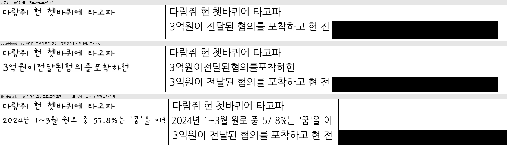
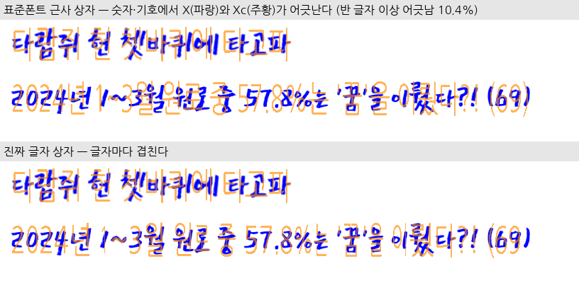
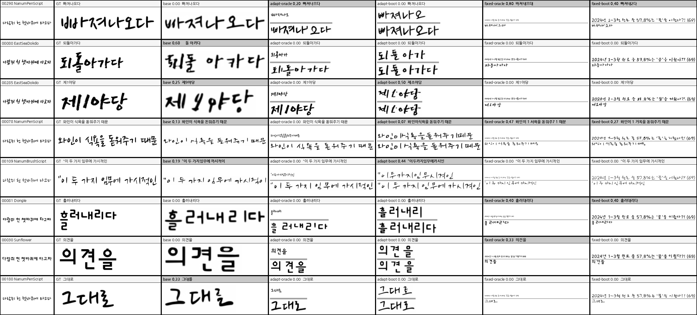
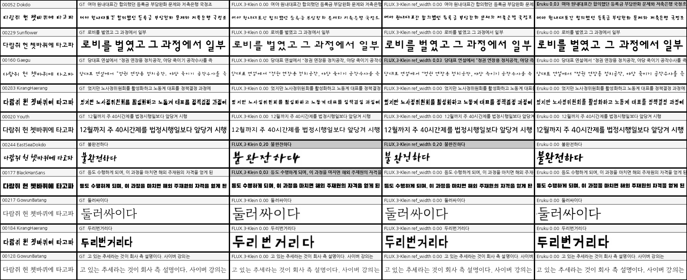

# 실험 로그 — InkSpire 한글 재현

> §1~§4 는 `Eruku_korean_finetuning/docs/EXPERIMENTS.md` §12 에서 옮겼다(2026-09-15). 원본 번호는 버리고 1 부터 다시 매겼다.
> 코드 블록의 `./eval.sh cer` 와 상대경로는 원본 repo 기준이다 — **CER 측정 경로는 원본 repo 에만 있다.**
> `finetune_runs/inkspire_*` 는 이 repo 로 옮겨왔고 `assets`/`data`/`model_zoo` 는 심링크다.
> 구현 상세·진단은 [`inkspire.md`](inkspire.md).

| § | 내용 | 판정 |
|---|---|---|
| 1 | 설정 | |
| 2 | 이미지 모델 FLUX.1-Fill LoRA | 재현 성공 |
| 3 | 레이아웃 모델 | 한 줄 생성엔 std layout 이 낫다 |
| 4 | Eruku 비교 — 자체 HTR | ~~Eruku 압승~~ → 리더 착시(§5) |
| 5 | Eruku 비교 — PP-OCRv6 재측정 | Eruku 0.018 vs InkSpire 0.040 |
| 6 | 논문 수치로 본 Eruku 대비 (IAM) | 논문 조건에선 InkSpire 우세 |
| 7 | 이미지 백본 FLUX.3-Image-Klein-Base | CER 0.040 → 0.026 |
| 8 | ref 보강 (inference loop) | 효과 없음 — 접음 |
| 9 | 스타일 지표 (HWD·FID) | 줄 폭 보정(`ref_width`) 후 HWD 는 InkSpire 0.93 < Eruku 0.99 |
| 10 | 결론 | |

논문: *Learning to Generate Stylized Handwritten Text via a Unified Representation of Style, Content, and Noise*
(Wang et al., ICLR 2026, `docs/inkspire.pdf`). 두 단계 분해 p(X, Xc | C, Xs) = p(Xc | C, Xs)·p(X | Xs, Xc) 를 합성 폰트
페이지로 재현한다. 코드: `custom_datasets/korean/page.py` · `models/inkspire.py` · `models/inkspire_klein.py` ·
`models/inkspire_layout.py` · `train/inkspire*.py` · `infer/inkspire.py` · `configs/inkspire*.yaml`.

## 1. 설정

| 항목 | 값 |
|---|---|
| 데이터 | 합성 폰트 페이지(`assets/fonts/train` 12,951종, NanumGothic 제외), line_h U(40,80), P=512 패치, R-Mask |
| 이미지 모델 | FLUX.1-Fill-dev + LoRA r=32/α=32 (115.9M, 논문 표 8 13종), R-APE, 텍스트 인코더 제거(빈 프롬프트 캐시), guidance 30 |
| 이미지 학습 | Prodigy lr 1 wd 0.01, batch 4, grad clip 1.0, 20k step, GPU 2 (H100 96GB). 실측 2.6 s/step → 20k ≈ 14.5h (계획 7~9h 과소) |
| 레이아웃 모델 | masked CFM transformer 10층/512/8h (33M) + line_emb, 정규화 버퍼, 무레퍼런스 모드 10% |
| 레이아웃 학습 | AdamW 1e-4, batch 160, 20k step |
| 추론 | one-shot: ref 한 줄(잉크 48px, pitch 77) + 마스크된 아래 줄, ODE 20 step. 레이아웃 = std layout(표준폰트 bbox) 또는 `--layout-ckpt` |
| 평가 | §4: 자체 HTR CER **중앙값·폭주율**(평균 금지). §5 이후: PP-OCRv6 corpus CER. style-ref = `"다람쥐 헌 쳇바퀴에 타고파"` |

## 2. 이미지 모델 — FLUX.1-Fill LoRA (oracle 레이아웃 val, std layout 평가)

```bash
GPU=2 ./train.sh fetch-flux                                # hf auth login + 라이선스 수락 선행, 34GB
GPU=2 ./train.sh inkspire --out finetune_runs/inkspire_smoke --max-steps 2 --batch-size 1 --P 256 \
    --num-workers 0 --val-every 1 --val-batches 1 --val-steps 2 --save-every 1
GPU=2 ./train.sh inkspire --out finetune_runs/inkspire_p512 --max-steps 2000 --val-every 500 --save-every 500
#   → finetune_runs/inkspire_p512/samples/val_s002000.png 육안 (첫 줄 스타일로 아래 줄에 읽히는 한글?)
GPU=2 ./eval.sh cer --ckpt inkspire:finetune_runs/inkspire_p512/lora_last --n 100 --coherent --binarize 200
GPU=2 ./train.sh inkspire --out finetune_runs/inkspire_p512 --resume finetune_runs/inkspire_p512/lora_step_002000 --max-steps 20000
```

| step | val loss | s/step | peak VRAM | val_s*.png 육안 | 자체 HTR CER 중앙값 (std layout, echo, n=100) |
|---|---|---|---|---|---|
| 500 | 0.193 | 2.6 (B=4, 0.39 it/s) | 30.6GB | ✅ 아래 줄 전부 ref 폰트 스타일로 재현, 숫자·일부 자모 오류 소수 | — |
| 1000 | 0.189 | 2.6 | 30.6GB | one-shot 몽타주(`_debug/inkspire_s1000.png`) 4 writer 전부 스타일 전이, 숫자 약함 | (§4 표 s1000 행) |
| 2000 | 0.184 | 2.6 | 30.6GB | ✅ | — |
| 13000 | 0.171 | 3.9 (GPU 경합) | 30.6GB | ✅ 정답과 거의 구분 불가, 오류는 숫자에 몰림 | **0.190** (n=300, +layout, style-ref) |
| 20000 | 0.168 | 2.5 | 30.6GB | ✅ 동일 | 0.222 (같은 조건) |

★ **val loss 는 끝까지 내려갔지만(0.193 → 0.168) CER 은 13k 가 20k 보다 낫다**(중앙값 0.190 vs 0.222, 폭주율 1.7% vs 2.7%).
손실로 체크포인트를 고르면 안 된다. 전체 평균 0.265 it/s(GPU 경합 포함) → 20k 에 약 21h.

## 3. 레이아웃 모델

```bash
GPU=2 ./train.sh inkspire-layout --out finetune_runs/inkspire_layout_smoke --max-steps 2 --batch-size 4 \
    --num-workers 0 --norm-batches 1 --val-every 1 --val-batches 1
GPU=2 ./train.sh inkspire-layout --out finetune_runs/inkspire_layout                # val_l1_px 하강·정체 확인
```

| step | val loss | 생성 토큰 bbox L1 (px, held-out v2/test) |
|---|---|---|
| 스모크 s2 (batch 4) | 1.31 | 45.2 (미학습 기준값) |
| 2000 | 0.333 | 11.2 |
| 4000 | 0.285 | 11.2 |
| 6000 | 0.261 | 12.8 |
| 8000 | 0.255 | 11.7 |
| 20000 | 미완주 | — |

실측 메모(2026-09-10):
- 첫 배치에서 1,049 토큰 페이지가 `max_len` 1024 를 넘어 크래시 → `KoreanLayoutDataset.MAX_TOKENS` 로 줄 경계 캡, 모델 `max_len` 2048.
- batch 160 × 최대 2,048 토큰이면 attention·FFN 활성화가 **76GB** 까지 감 → MAX_TOKENS 1024 로 캡(초과는 pitch≈42px 극단뿐).
  1024 캡 후에도 이미지 모델과 동시 학습 시 GPU 2 83GB, 이미지 run 속도 0.26→0.11 it/s 로 반토막 → 레이아웃은 s8000 에서 중단.
- 속도 0.94 it/s(단독) → 20k 는 6h. 계획의 "40분"은 페이지 렌더 병목을 과소평가한 것. bbox L1 은 s2000 부터 11~12px 정체(val loss 는 계속 하강) — 20k 가 필요한지는 의문.
- 추론 관찰: 줄 시작 Δx(= −이전 줄 폭)를 가장 못 맞춰 줄이 오른쪽으로 밀림(학습 줄은 page_w 를 채우지만 추론 줄은 짧음)
  → `infer/inkspire.py` 에서 줄마다 첫 토큰을 좌측 여백으로 평행이동(학습 페이지는 전부 좌측 시작). 크기·간격은 예측값 유지.
- 진단(2026-10, `inkspire.md` §9.4): 짧은 단독 줄의 첫 글자 오차 142px 가 원인. 긴 줄 아래 3번째 줄로 쓰게 하면 반듯하다.

## 4. Eruku 비교 — 자체 HTR (n=300, coherent, binarize 200, seed 0)

> ★ **2026-10-20 정정:** 이 절의 자체 HTR(`aux_htr_ko/htr_s20000`)은 같은 폰트 렌더로 학습된 리더라 InkSpire 출력을 과하게 나쁘게 읽었다.
> 판정은 §5 를 따른다. 이 표는 레이아웃 모델 기여(std layout vs +layout)를 가르는 용도로만 남긴다.

```bash
BEST=finetune_runs/eruku_corpusmax/checkpoint_last.pth
INK=inkspire:finetune_runs/inkspire_p512/lora_last,finetune_runs/inkspire_layout/checkpoint_last.pth
for F in assets/fonts/ref assets/fonts/test assets/custom_hw_fonts; do for CK in $BEST $INK; do
  GPU=2 ./eval.sh cer --ckpt $CK --fonts-dir $F --n 300 --coherent --binarize 200 --seed 0 \
      --style-ref-text "다람쥐 헌 쳇바퀴에 타고파" --out finetune_runs/_eval/inkspire_$(basename $F)_${CK%%:*}_sref.txt
  GPU=2 ./eval.sh cer --ckpt $CK --fonts-dir $F --n 300 --coherent --binarize 200 --seed 0 \
      --out finetune_runs/_eval/inkspire_$(basename $F)_${CK%%:*}_echo.txt
done; done
```

| 세트 | 모델 | 프로토콜 | 평균 | 중앙값 | 폭주율 | GT 바닥 |
|---|---|---|---|---|---|---|
| seen v2/train | Eruku corpusmax s45000 | echo | 0.085 | 0.000 | 0.3% | 0.005 |
| seen v2/train | Eruku corpusmax s45000 | style-ref | 0.083 | 0.000 | 0.0% | 0.005 |
| seen v2/train | InkSpire s20000 std layout | echo | 0.247 | 0.102 | 3.0% | 0.005 |
| seen v2/train | InkSpire s20000 std layout | style-ref | 0.225 | 0.095 | 2.0% | 0.005 |
| seen v2/train | InkSpire s20000 + layout | echo | 0.325 | 0.200 | 2.7% | 0.005 |
| seen v2/train | InkSpire s20000 + layout | style-ref | 0.330 | 0.143 | 1.7% | 0.005 |
| held-out v2/test | Eruku corpusmax s45000 | echo | 0.123 | 0.029 | 0.3% | 0.026 |
| held-out v2/test | Eruku corpusmax s45000 | style-ref | 0.064 | 0.000 | 0.0% | 0.026 |
| held-out v2/test | InkSpire s20000 std layout | echo | 0.353 | 0.250 | 5.0% | 0.026 |
| held-out v2/test | InkSpire s20000 std layout | style-ref | 0.278 | 0.197 | 2.3% | 0.026 |
| held-out v2/test | InkSpire s20000 + layout | echo | 0.345 | 0.254 | 1.3% | 0.026 |
| held-out v2/test | InkSpire s20000 + layout | style-ref | 0.368 | 0.222 | 2.7% | 0.026 |
| held-out v2/test | InkSpire **s13000** + layout (최적 체크포인트) | style-ref | 0.324 | 0.190 | 1.7% | 0.026 |
| custom_hw 4 | Eruku corpusmax s45000 | echo | 0.198 | 0.056 | 0.0% | 0.209 |
| custom_hw 4 | Eruku corpusmax s45000 | style-ref | 0.083 | 0.000 | 0.0% | 0.209 |
| custom_hw 4 | InkSpire s20000 std layout | echo | 0.419 | 0.300 | 5.7% | 0.209 |
| custom_hw 4 | InkSpire s20000 std layout | style-ref | 0.346 | 0.226 | 3.3% | 0.209 |
| custom_hw 4 | InkSpire s20000 + layout | echo | 0.422 | 0.333 | 2.3% | 0.209 |
| custom_hw 4 | InkSpire s20000 + layout | style-ref | 0.384 | 0.253 | 2.3% | 0.209 |

이 리더로 본 관찰 (리더 착시를 걷어내도 방향이 유지되는 것만):
1. **레이아웃 모델이 오히려 손해다.** 6 개 비교쌍 전부 std layout 이 같거나 낫다(held-out style-ref 0.197 vs 0.222).
   단 한 줄씩 생성하는 이 프로토콜에서만 — §3 진단 참고.
2. **체크포인트 선택이 손실과 어긋난다.** val loss 최저는 s20000 이지만 CER 최저는 s13000.
3. ~~굵은 폰트 약점(BagelFatOne 0.423)~~ 은 리더 착시. 붓글씨류(NanumBrushScript) 약점과 숫자 오류는 §5 에서도 남는다.

몽타주: `finetune_runs/inkspire_p512/_eval/`(s20000 + 레이아웃), `_eval_best/`(s13000 + std layout),
`_eval_pangram/`(held-out 폰트 + 한글 pangram ref, `experiments/gencmp_split.py`) — 마지막이 공정한 조건이고 육안으로 Eruku 와 엇비슷하다.

## 5. Eruku 비교 — PP-OCRv6 재측정 (2026-10-20)

독립 리더 PP-OCRv6(`HERIUN/PP-OCRv6-medium-rec-ko-printed-handwriting`, 원본 repo `.venv-paddle`). §4 와 같은 표본
(held-out 16폰트, style-ref pangram, coherent, n=300, seed 0). 경로는 `experiments/cer_dump.py` docstring:
`plan`(원본 repo env) → `gen`(여기) → `eval/ppocr_rec.py --save-preds`(원본 repo). 결과 `finetune_runs/_cer/*`. 분해·해석은 `inkspire.md` §9.6.

| 조건 | 자체 HTR 중앙값 | PP corpus CER | PP 평균 / 중앙값 | 한글 | 숫자 | 기호 |
|---|---|---|---|---|---|---|
| GT 렌더 (리더 바닥) | 0.026 | 0.006 | 0.005 / 0 | | | |
| Eruku corpusmax s45000 | 0.000 | **0.018** | 0.021 / 0 | 1.9% | 2.5% | 2.7% |
| InkSpire s13000 std layout | 0.190 | 0.040 | 0.045 / 0 | 3.5% | 12.7% | 8.9% |
| + `tight_mask` | — | 0.034 (부호검정 p=0.33) | 0.043 / 0 | 2.8% | 7.0% | 8.9% |
| + 전사 없음 (`--style-text none`) | — | 0.720 (134/300 백지) | 0.759 / 1.0 | 75.6% | 62.7% | 78.1% |
| + Xc 첫 줄에 목표 텍스트 | — | 0.355 | 0.466 / 0.409 | 40.3% | 33.5% | 40.2% |
| + Xc 첫 줄에 ref 의 PP-OCR 판독 | — | 0.041 | 0.046 / 0 | 3.6% | 12.0% | 8.9% |

- 자체 HTR 중앙값 0.190 → PP 중앙값 0. "크게 진다"는 리더 착시였지만 **corpus CER 은 여전히 Eruku 가 2배 낫다.**
- 격차는 숫자·기호·붓/펜글씨와 한글 중성(모음 짧은 획)에 몰린다.
- **ref 전사가 필수다.** 이미지 모델이 Xc ref 줄을 글자별 대응표로 쓴다 — 비우면 붕괴, 목표 텍스트로 채우면 ref 글자 모양이 섞인다.

## 6. 논문 수치로 본 Eruku 대비 (IAM Lines, 2026-10-22)

InkSpire 논문 표 2 에 Eruku/Emuru 행은 없지만 **baseline 4행이 Eruku 논문(arXiv 2510.23240, WACV 2026) 표 3 IAM Lines 와 숫자까지 같다**
(HWT FID 44.72 / HWD 2.97 / ΔCER 0.33, One-DM 43.89 / 2.83 / 0.13, DiffPen 12.89 / 2.13 / 0.03,
InkSpire 의 "VATr" 34.00 / 2.38 / 0.03 = Eruku 표의 **VATr++** 행). 같은 Pippi et al. 평가 프로토콜 수치를 옮겨 쓴 것이라 한 표로 이을 수 있다.

| IAM Lines | FID↓ | HWD↓ | ΔCER↓ | IAM 학습 |
|---|---|---|---|---|
| DiffPen | 12.89 | 2.13 | 0.03 | ✓ |
| Emuru | 13.89 | 1.87 | 0.14 | ✗ (zero-shot) |
| Eruku (γ=1.25) | 16.40 | 1.70 | 0.06 | ✗ (zero-shot) |
| **InkSpire** | **7.92** | **0.62** | **0.01** | ✓ |

- **논문 조건에서는 InkSpire 가 전 지표 우세**, 특히 HWD(스타일) 0.62 vs 1.70 로 차이가 크다.
- 단 조건이 다르다: (a) InkSpire 는 IAM 으로 학습, Eruku 는 IAM 미학습(zero-shot). (b) InkSpire 는 ref 의 전사 + 글자 bbox 정답 주석을 받는다.
  (c) InkSpire 의 IAM 추론은 같은 writer 의 둘째 줄로 첫 줄을, 첫 줄로 나머지를 만든다(논문 §4.3) — 같은 문단의 실제 줄이 ref 다.
- 우리 한글 재현(§5)과 방향이 반대인 이유 후보: 학습 분포 안(IAM seen) vs 밖(held-out 폰트), FID/HWD 는 스타일 지표이고 우리는 CER 만 쟀다,
  P=1024 vs 512. 한글 HWD 비교는 §9 — 한글 조건에선 Eruku 가 앞선다.

## 7. 이미지 백본 FLUX.3-Image-Klein-Base — `black-forest-labs/flux-3-image-klein-base` (2026-10-21~)

HF [`black-forest-labs/flux-3-image-klein-base`](https://huggingface.co/black-forest-labs/flux-3-image-klein-base)(FLUX.3-Image-Klein-Base, 5.54B, 게이트 repo · 비상업 라이선스)에
같은 LoRA 학습을 얹는다. `train/inkspire.py --backbone klein`, 모듈 `models/inkspire_klein.py`(models/inkspire.py 와 같은 API).
`infer/inkspire.py backbone()` 이 LoRA 키(`mode_blocks`)로 FLUX.3-Image-Klein-Base 를 자동 판별하므로 `cer_dump.py`·`show` 는 그대로 쓴다.

| 항목 | FLUX.1-Fill-dev (§2) | FLUX.3-Image-Klein-Base |
|---|---|---|
| 조건 주입 | 채널 concat (X·(1−M), M, Xc) | 별도 `image_cond` 스트림(timestep 0): cond1 = X·(1−M)(마스크 영역 회색, l=−1), cond2 = Xc (l=−2) |
| 위치 | R-APE (회전) | 생성·조건 토큰이 같은 (h, w) id → **APE 가 기본 구조**. 회전 없음 |
| 텍스트 인코더 | 빈 프롬프트 캐시 | Qwen3-VL-4B 빈 프롬프트 캐시(`model_zoo/klein_empty_prompt.pt`) |
| 샘플링 | guidance 30 | shift 6.93, guidance 임베딩 없음(CFG 미사용). 매 step 비마스크 토큰을 (1−σ)x0+σz 로 덮어씀 |
| LoRA | r32, 115.9M | r32, 71.2M (image/image_cond mode 블록 + single 블록 attn·ff, x_embedders) |
| 학습 | 2.6 s/step, 30.6GB | 0.27 it/s(GPU 경합), 18GB, 13k step ≈ 13h |

**VAE 상한(`experiments/vae_recon.py`, GT 렌더 왕복, PP corpus CER, n=300):** VAE 는 병목이 아니다 — 둘 다 GT 와 같다.

| | GT | FLUX.1-Fill-dev VAE | FLUX.3-Image-Klein-Base VAE (AutoencoderKLFlux2) |
|---|---|---|---|
| 줄높이 64 | 0.0056 | 0.0061 | 0.0062 |
| 줄높이 32 | — | 0.0079 | 0.0079 |

환경: `Flux3Transformer2DModel` 때문에 diffusers git main(0.42.0.dev0) + transformers 5.20.2 로 올렸다. FLUX.1 출력은 bf16 잡음 수준(평균 0.5/255)만 바뀐다.

**학습** (`finetune_runs/inkspire_klein_p512`, P=512 batch 4 Prodigy, §2 와 같은 데이터·마스크):

| step | 500 | 2000 | 6000 | 10000 | 13000 |
|---|---|---|---|---|---|
| val loss | 0.119 | 0.106 | 0.097 | 0.094 | 0.092 |

latent 공간이 달라 FLUX.1 val loss 와 직접 비교 불가. s500 부터 4폰트 모두 스타일 재현, 남는 오류는 FLUX.1 과 같은 유형(모음 짧은 획·숫자:
"컬럼비아→걸럼비아", "210,679→210,6D9").

**평가 (§5 와 같은 표본·리더):**

| 조건 | PP corpus CER | PP 평균 / 중앙값 | 한글 | 숫자 | 기호 |
|---|---|---|---|---|---|
| FLUX.1-Fill-dev s13000 (§5) | 0.040 | 0.045 / 0 | 3.5% | 12.7% | 8.9% |
| FLUX.3-Image-Klein-Base s6000 | 0.039 | 0.049 / 0 | 4.2% | 1.9% | 3.6% |
| FLUX.3-Image-Klein-Base s13000 | **0.026** | 0.028 / 0 | 2.5% | 4.4% | 1.3% |
| (참고) Eruku corpusmax s45000 (§5) | 0.018 | 0.021 / 0 | 1.9% | 2.5% | 2.7% |

결과 `finetune_runs/_cer/klein_s{006000,013000}_test_sref`, 분해 `experiments/cer_analyze.py`. 폭주율 0%, GT 바닥 0.0056.

- **같은 step 수(13k)에서 FLUX.1-Fill-dev 대비 CER 0.040 → 0.026(−35%).** 개선은 숫자(12.7 → 4.4%)·기호(8.9 → 1.3%)·라틴(23.5 → 0%)에
  몰렸다 — FLUX.1 의 약점 그대로였던 곳. 기호는 Eruku(2.7%)보다 낫다.
- **한글은 3.5 → 2.5% 로 Eruku(1.9%)와 아직 격차.** 틀린 자모는 여전히 중성 41%(원→윈, 중→증, 로→르) — 모음 짧은 획 약점은 백본을 바꿔도 남는다.
- 폰트별: 붓·펜글씨가 크게 좋아졌다(NanumBrushScript 0.173 → 0.029, NanumPenScript 0.053 → 0.028). 대신 EastSeaDokdo 0.026 → 0.077,
  Dongle·BlackHanSans 0 → 0.03~0.04 로 나빠졌다(폰트당 n=11~29 라 잡음 폭 큼).
- s6000 → s13000 에 0.039 → 0.026 으로 내려가서 20k 까지 연장했다(resume, Prodigy 상태 복원) → **20k 는 나빠진다** — 아래.

**20k 연장 (2026-10-23, `ref_width` 켬, 같은 표본):** val loss 는 13k 이후 0.092 로 평평. 두 백본 모두 20k 가 13k 보다 **유의하게 나쁘다.**

| | 13k CER | 20k CER | 20k vs 13k 표본별 나음 / 나쁨 | HWD 13k → 20k |
|---|---|---|---|---|
| FLUX.3-Image-Klein-Base | **0.023** | 0.034 | 30 / 71 (p<0.001) | 0.929 → 0.909 |
| FLUX.1-Fill-dev | 0.026 | 0.038 | 34 / 70 (p<0.001) | 0.905 → 0.852 |

20k 에서 한글이 1.9 → 3.1%(Klein), 2.1 → 3.1%(FLUX.1) 로 나빠지고 HWD 는 조금 좋아진다 — 필체를 더 닮는 대신 획이 흐트러진다.
FLUX.1 에서 자체 HTR 로 본 "13k > 20k"(§2)는 리더 착시가 아니었다. **최종 체크포인트는 두 백본 모두 13k.**

## 8. ref 보강 — inference loop (2026-10-22)

### 왜

ref 는 한 줄("다람쥐 헌 쳇바퀴에 타고파", 11음절)뿐이라 목표 글자 대부분은 ref 에 없다. 가설: **ref 에 없는 글자라서 스타일 복제가
약하다.** 그렇다면 목표를 만들기 전에 보강 줄을 하나 더 깔아 필체 예시를 늘리면 나아질 것이다. 실사용에서 보강 줄은 모델이
먼저 생성한 결과로 만든다(반복 추론 = inference loop).

기존 결과가 가설을 지지했다 — FLUX.3-Image-Klein-Base s13000 에서 ref 에 **있는** 음절은 0.5%, **없는** 음절은 2.6% 틀린다(5배).
단 Eruku 도 0.3% vs 2.0% 로 같은 경향이라, ref 음절이 원래 쉬운 글자라서 생긴 차이가 섞여 있을 수 있었다.

### 무엇을 했나

`InkSpireGen.prepare(..., ctx=[(이미지, 전사[, 글자 x 상자])])` 로 ref 아래에 보이는 줄을 추가하고 목표 줄을 그만큼 내린다
(ctx 없으면 HEAD 와 픽셀 동일 확인). 실행은 `experiments/cer_dump.py gen --ctx {fixed,adapt} --ctx-src {oracle,boot}`.
보강 줄을 두 축으로 나눠 2×2 조건을 돌렸다.

| | 보강 줄 내용 |
|---|---|
| **fixed** | 목표와 무관한 고정 문장 `2024년 1~3월 원로 중 57.8%는 '꿈'을 이뤘다?! (69)` — 숫자 10종·기호·중성 오류 잦은 음절(원·로·중·는) |
| **adapt** | 목표 음절 중 ref 에 없는 것(등장 순, 중복·공백 제거). 예: "3억원이 전달된 혐의를…" → `3억원이전달된혐의를…` |

| | 보강 줄 이미지 | 의미 |
|---|---|---|
| **oracle** | 그 폰트로 렌더한 진짜 필체 + 진짜 글자 x 상자 | 실사용 불가. 보강이 완벽할 때의 **상한** |
| **boot** | 모델이 ref 만 보고 먼저 생성한 것 | 실사용 가능한 inference loop |



모델 입력 [X | Xc | 마스크(검정=생성)]. 위 = 기준선, 가운데 = adapt-boot, 아래 = fixed-oracle.
캔버스 폭은 목표 줄에 맞춰 자르므로(§2 `trim_ref`, 빈 공간 생성 방지) 긴 보강 줄은 목표 폭에서 잘린다.

**기대:** oracle 은 기준선보다 확실히 낫고(특히 ref 에 없는 음절·숫자), boot 는 그 사이.
oracle 조차 효과가 없으면 이 방향은 접는다(사전 결정).

### 중간에 발견한 것 — X↔Xc 상자 어긋남

처음 oracle 은 보강 줄의 Xc 상자를 ref 처럼 **표준폰트 bbox 를 줄 폭에 맞춰 늘린 근사**로 줬는데, 기준선보다 나빴다(adapt 0.036, fixed 0.047).
진짜 필체는 글자 폭이 표준폰트와 달라 상자가 어긋난다:

| 줄 | 평균 중심 어긋남 | 반 글자 이상 어긋난 글자 |
|---|---|---|
| ref | 0.05 글자폭 | 0% |
| adapt 보강 줄 | 0.08 | 2.1% |
| fixed 보강 줄 (숫자·기호) | 0.22 | **10.4%** |



어긋난 짝을 모델이 대응표로 배워 이웃 글자 오류("흘러내리다 → 흘러대리다")를 냈다. boot 는 생성이 처음부터 표준폰트 상자에 맞춰
그려지므로 어긋남이 없다. → oracle 에 진짜 글자 x 상자(`render_line` 이 주는 것 = 논문의 GT 레이아웃 자리)를 주고 다시 쟀다.
**교훈: 보이는 줄을 추가할 때는 X↔Xc 짝이 정확해야 한다 — 어긋나면 안 넣느니만 못하다.**

### 결과 (FLUX.3-Image-Klein-Base s13000, held-out 16폰트, n=300, PP-OCRv6, 시드 1개)

| 조건 | CER | 한글 | 숫자 | 기호 | 짧은 목표(≤8자) | 긴 목표 | 기준선 대비 표본별 나음/나쁨 | 부호검정 p |
|---|---|---|---|---|---|---|---|---|
| 기준선 (§7) | 0.026 | 2.5% | 4.4% | 1.3% | 0.033 | 0.025 | — | — |
| adapt-oracle | 0.024 | 2.2% | 2.5% | 4.5% | 0.019 | 0.024 | 58 / 53 | 0.64 |
| adapt-boot | 0.021 | 1.8% | 2.5% | 3.1% | 0.047 | 0.020 | 60 / 57 | 0.78 |
| fixed-oracle | 0.034 | 3.2% | 2.5% | 6.7% | 0.049 | 0.033 | 55 / **88** | **0.006** |
| fixed-boot | 0.028 | 2.6% | **0.6%** | 6.2% | 0.044 | 0.027 | 51 / 65 | 0.19 |
| (상자 근사) adapt / fixed-oracle | 0.036 / 0.047 | | | | | | 57/73 · 38/114 | 0.16 · <0.001 |

결과 `finetune_runs/_cer/klein_s013000_ctx_*` (근사 상자판은 `*_oracle_stdbox`). 각 덤프의 `ctx/` 에 보강 줄 이미지.



조건 간 CER 차이가 큰 8표본(차이 큰 것만 골라 실제보다 극적으로 보인다). 보강 줄이 있는 셀은 회색 선 위 = 보강 줄, 아래 = 최종 생성.
fixed 열의 보강 줄은 전체 문장을 한 셀에 넣느라 작게 보일 뿐, 실제 입력에선 목표 폭에서 잘린다.

1. **상한(oracle)이 기준선과 같다.** 목표 글자의 진짜 필체·진짜 상자를 줘도 adapt-oracle 58 나음 / 53 나쁨. 그림에서 보듯 모델은
   보강 줄의 같은 글자를 **베끼고**, 진짜 필체를 베끼면 맞게 나오지만(00285 "제1야당", 00080 "되돌아가다") 원래 맞던 표본이
   새로 틀리는 경우도 비슷하게 많다.
2. **boot 는 1차 생성의 복사다.** 00285 1차 "제L야당" → 최종 "제L야당", 00109 "임무시겨인" 그대로. 최종 = 시드만 다른 1차 생성이므로
   새 정보가 없다. corpus 0.021 은 표본별로 60 / 57(p=0.78) — 긴 문장 몇 개가 만든 잡음이다.
3. **fixed 는 유의하게 손해다**(oracle p=0.006). 숫자는 좋아지지만(4.4 → 0.6~2.5%) 기호가 1.3 → 6~7% 로 나빠진다 —
   보강 줄의 따옴표·괄호·% 모양이 목표의 다른 기호로 번지는 것으로 보인다. 목표와 겹치는 글자가 없으니 베낄 것도 없다.
4. **처음 가설이 틀린 이유:** "ref 에 있는 음절 0.5% vs 없는 음절 2.6%" 는 대부분 ref 음절이 쉬워서였다(oracle 로 확인).
   남은 오류는 모음 짧은 획 같은 **획 정확도**이지 예시 커버리지가 아니다.

**판정: 접는다.** 한계 — 시드 1개. 캔버스 높이가 바뀌면 같은 시드라도 노이즈가 달라 표본의 ~1/3 이 조건과 무관하게 흔들린다.
20% 수준 효과를 가리려면 시드 3개쯤 필요하지만 상한에서 신호가 없어 그 비용을 쓸 근거가 없다. 코드(`ctx`)는 기본값이 꺼져 있어 남겨 둔다
— 다줄·문단 생성(보이는 줄이 여러 개인 캔버스)에 그대로 쓸 수 있다.

재현:
```bash
I=/data/work/dgkang/inkspire_korean; E=/data/work/dgkang/Eruku_korean_finetuning
O=$I/finetune_runs/_cer/klein_s013000_ctx_adapt_boot; mkdir -p $O; cp $I/finetune_runs/_cer/s13000_test_sref/plan.json $O/
cd $I && CUDA_VISIBLE_DEVICES=2 PYTHONPATH=$I .venv/bin/python experiments/cer_dump.py gen $O \
    --ckpt inkspire:finetune_runs/inkspire_klein_p512/lora_step_013000 --ctx adapt --ctx-src boot
cd $E && .venv-paddle/bin/python eval/ppocr_rec.py $O/gen --save-preds
python docs/_gen_inkspire_ctx.py      # 그림 14~16 (추론 없음, 덤프만 읽는다)
```

## 9. 스타일 지표 — HWD · FID · BFID · KID (2026-10-22)

### 왜

§6 에서 논문 IAM 수치로는 InkSpire 가 스타일(HWD 0.62 vs Eruku 1.70)에서 크게 앞섰고, §10 결론은 "InkSpire 를 다시 꺼낼 근거는
CER 이 아니라 스타일"이었다. 한글에서도 그런지 잰다.

### 어떻게

`experiments/style_scores.py` — 원본 repo `.venv` 의 `hwd` 패키지(Eruku 논문 표 3 과 같은 구현, 높이 32). 추론 없이 §5·§7 의 덤프를 읽는다.
real = 같은 표본의 GT 렌더, fake = 각 모델 출력, 폴더명 = 폰트(필기자) → HWD 는 폰트별 VGG16 특징 거리의 평균.
하한 기준으로 **std-font**(목표 텍스트를 표준폰트 NanumGothic 으로 렌더 = 스타일 복제 0)를 같이 잰다.

★ **정규화 필수.** 덤프마다 위아래 여백(GT 30% / InkSpire 17% / Eruku 20%)과 배경(InkSpire 249~251, 나머지 255)이 달라
높이 32 로 줄이면 글자 크기·밝기 차이를 FID 가 잡는다 — 정규화 전에는 InkSpire FID(57.7)가 std-font(59.7)와 비슷했다.
모든 이미지(real 포함)를 배경 → 255, 잉크 bbox 크롭, 잉크 높이 15% 여백으로 맞춘다(기본, `--raw` 로 끔).

### 결과 (held-out 16폰트, n=300, 정규화)

| | HWD↓ | FID↓ | BFID↓ | KID↓ | 출력 폭 vs GT (중앙값) |
|---|---|---|---|---|---|
| FLUX.3-Image-Klein-Base s13000 | 1.338 | 45.7 | 24.0 | 0.021 | +23% |
| **FLUX.3-Image-Klein-Base s13000 + `ref_width`** | **0.929** | 37.3 | 16.2 | 0.014 | **7%** |
| FLUX.1-Fill-dev s13000 | 1.306 | 48.2 | 22.3 | 0.024 | +22% |
| **Eruku s45000** | **0.989** | **26.0** | **15.7** | **0.003** | **7%** |
| std-font (스타일 복제 0) | 3.281 | 60.1 | 45.3 | 0.030 | +18% |

결과 `finetune_runs/_cer/style_scores.json`. 정규화 전(`--raw`): HWD 1.58 / 1.54 / 1.35 / 3.40, FID 57.7 / 61.6 / 34.8 / 59.7 (같은 순서).

1. **한글 합성 폰트 조건에서는 스타일도 Eruku 가 앞선다.** 논문 IAM(§6)과 방향이 반대다. 두 InkSpire 백본은 서로 비슷하다 —
   FLUX.3-Image-Klein-Base 는 CER 만 좋아졌고 스타일은 그대로다.
2. **원인 후보: 줄 기하가 표준폰트를 따른다.** std layout 은 목표 줄 글자 상자를 NanumGothic 그대로 두므로 InkSpire 출력의 줄 폭은
   GT 보다 22~23% 넓다 — 스타일 복제 0 인 std-font(18%)보다도 멀다. Eruku 는 자간·글자 폭까지 생성해 7% 다. 글자 모양은 필체를
   닮아도 줄 모양이 NanumGothic 이다. 논문은 이 자리에 레이아웃 모델을 쓰고(§3, 우리는 한 줄 생성에서 CER 손해) IAM 은 GT 레이아웃이 있다.
3. **재학습 없는 보정 `ref_width` 로 줄 폭을 맞추면 HWD 가 Eruku 를 넘는다.** ref 줄은 이미 "손글씨 폭 / 표준폰트 폭" 비율을
   안다(ref 상자를 그 비율로 늘리고 있었다). 같은 비율을 목표 줄 상자 x 에도 곱한다 — `InkSpireGen(ref_width=True)` /
   `inkspire:<lora>,ref_width=1`. **2026-10-22 부터 기본값 켬** — §2~§8 의 수치는 꺼진 상태(재현은 `,ref_width=0`). 출력 폭 오차 23% → 7%(Eruku 와 같음), **HWD 1.338 → 0.929(Eruku 0.989)**, FID 45.7 → 37.3,
   BFID 24.0 → 16.2(Eruku 15.7). FID·KID 는 여전히 Eruku 가 낫다.
   **CER 은 그대로** — 0.026 → 0.023, 표본별 54 나음 / 50 나쁨(p=0.70). 결과 `finetune_runs/_cer/klein_s013000_refwidth`.



무작위 10표본(`experiments/montage.py --seed 3`). 가운데 두 열 = 기준선 / `ref_width`. 00184 "두리번거리다", 00244 "불완전하다" 처럼
기준선은 자간이 표준폰트만큼 벌어지고, `ref_width` 는 GT 처럼 붙는다.

**`ref_width` 는 CER 도 올린다 — FLUX.1-Fill-dev 에서 크게** (2026-10-23, 결과 `finetune_runs/_cer/{flux1,klein}_s0*_rw`):

| ref_width 켬 | CER | 한글 | 숫자 | 기호 | HWD | FID | BFID |
|---|---|---|---|---|---|---|---|
| FLUX.3-Image-Klein-Base s13000 | **0.023** (끔 0.026, p=0.70) | 1.9% | 3.2% | 2.2% | 0.929 | 37.3 | 16.2 |
| FLUX.1-Fill-dev s13000 | 0.026 (끔 0.040, **83 / 51, p=0.006**) | 2.1% | 11.4% | 8.9% | 0.905 | 37.5 | 16.0 |
| Eruku s45000 | **0.018** | 1.9% | 2.5% | 2.7% | 0.989 | **26.0** | **15.7** |

FLUX.1 은 표준폰트 자간 캔버스(학습 분포 밖 — 학습 Xc 상자는 늘 그 폰트의 실제 자간)에 약했던 것이고, 그 몫이 한글 3.5 → 2.1% 로 풀렸다.
남은 FLUX.1 약점은 숫자·기호·라틴(학습 한계) — 거기서 FLUX.3-Image-Klein-Base 가 낫다. Eruku 는 여전히 CER 에서 유의하게 앞선다
(Klein s13000 rw 대비 표본별 79 / 32, p<0.001). 스타일은 HWD 는 InkSpire, FID·KID 는 Eruku.

한계: 비율은 ref 한 줄 전체의 평균이라 글자별 폭 차이(예: 숫자·라틴만 좁은 폰트)는 못 맞춘다 — 그건 레이아웃 모델의 몫이다.
GT 가 폰트 렌더라 "줄 폭 = 폰트 고유 자간" 이 정확히 정해진 조건이다. 실손글씨는 줄마다 자간이 흔들려 이득이 줄 수 있다.

## 10. 결론

- **한글 한 줄 생성(우리 측정, CER)은 Eruku 가 앞선다** — PP corpus 0.018 vs 0.040. InkSpire 는 ref 전사가 필수라 실사용 제약도 크다.
- **논문 조건(IAM, 스타일 지표)에서는 InkSpire 가 Eruku 를 크게 앞선다**(§6, HWD 0.62 vs 1.70) — 다만 IAM 학습 여부·주석 입력이 달라 공정 비교는 아니다.
- 그래서 InkSpire 를 다시 꺼낼 근거는 CER 이 아니라 **스타일 충실도(HWD)** 와 다줄·편집 기능이다 → HWD 는 §9 에서 쟀다.
- **FLUX.3-Image-Klein-Base 백본(§7)은 한글 CER 격차를 절반 넘게 줄였다**(0.040 → 0.026, Eruku 0.018). 숫자·기호 약점은 사실상 해소, 남은 건 한글 모음 획.
  ref 전사 필수라는 구조적 제약(§5)은 그대로다.
- **스타일(§9): 줄 폭 보정(`ref_width`, 기본 켬)을 켜면 HWD 는 InkSpire 가 앞선다**(0.91~0.93 vs Eruku 0.99, 끄면 1.34). FID·KID 는 Eruku 가 낫다.
  CER 은 Eruku 0.018 vs InkSpire 최고 0.023(FLUX.3-Image-Klein-Base s13000 + ref_width) — 표본별로도 Eruku 가 유의하게 낫다.
  `ref_width` 는 FLUX.1-Fill-dev CER 도 0.040 → 0.026 으로 올렸다. 두 백본 모두 **13k 가 최종**(20k 는 CER 유의하게 나쁨, §7). 정리하면 **글자 정확도는 Eruku, 필체 거리(HWD)는 InkSpire(+ref_width)** 이고 둘 다 차이는 작다.
- **ref 보강(§8)은 효과가 없다.** 목표 글자의 진짜 필체를 보여줘도 상한이 기준선과 같다 — 남은 오류는 획 정확도다.

생성 결과 비교: 저장된 덤프를 합치기만 하는 `experiments/montage.py`(추론 없음, `--pick random|worst|diff`, `--font`, `--runs`, `--show-ctx`).
